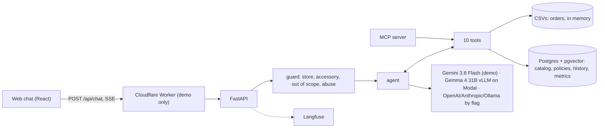

# Empório da Música: customer-support agent

*Versão em português: [README.md](README.md).*

A customer-support assistant for the Empório da Música instrument store. It answers in the tone of a salesperson who knows music, looks up the catalog, promotions and orders through deterministic tools, and searches the store's policy manual for the rules. It is all Python, behind a web chat that simulates WhatsApp. The agent speaks Brazilian Portuguese to customers.

**Demo:** https://emporio.fastmind.site (credentials are sent by e-mail, outside the repository).
**Real demo conversations (pt-BR):** [catalog and price](examples/01-catalogo-e-preco.md), [promotion and installments](examples/02-promocao-e-parcelamento.md), [identified customer changing her mind](examples/03-arrependimento-cliente-identificado.md), [anonymous order with verification](examples/04-pedido-anonimo-com-verificacao.md), [accessory and out of scope](examples/05-acessorio-e-fora-de-escopo.md).


Stack: LangGraph + FastAPI, Postgres with pgvector, React, Langfuse. The demo runs Gemini 3.8 Flash; Gemma 4 31B on Modal is one flag away.

## How to run

Requirements: Docker, [uv](https://docs.astral.sh/uv/), Node ≥ 22.12 and `make`. Local Langfuse needs about 2.3 GB of RAM. On the first run, `make up` downloads the embedding model (~470 MB) and the Langfuse images (~7 min).

```bash
cp .env.example .env
make setup        # dependencies and pre-commit hooks
make web-keys     # writes SESSION_SECRET into .env
```

In `.env`, set `DEMO_EMAIL` and `DEMO_PASSWORD`: the login of your local demo, chosen by you. The local Langfuse keys are generated for you.

**Shortest path, no key at all:** the scripted test model brings up the whole system.

```bash
EMPORIO_FAKE_MODEL=1 make up      # open http://localhost:8000
```

**With a real model:** put the provider key in `.env` (`GEMINI_API_KEY`, `OPENAI_API_KEY` or `ANTHROPIC_API_KEY`) and pick the provider on the command line or in `LLM_PROVIDER`. A missing key makes `make up` fail in seconds, before Docker starts.

```bash
make up PROVIDER=gemini           # or openai, anthropic; gemma needs VLLM_BASE_URL and VLLM_API_KEY
```

**With the model on your machine:** `make up PROVIDER=local` runs Gemma 4 through [Ollama](https://ollama.com/download) and picks the model size by the machine's memory (on a Mac, install the Ollama app first). Sizes and estimated times are in [docs/local-model.md](docs/local-model.md).

Other useful commands:

| Command | What it does |
|---|---|
| `make dev` | API with reload on :8000 plus Vite, for working on the code |
| `make chat ARGS="--as-customer 14 --provider gemini"` | the agent in the terminal, as customer 14 |
| `make mcp` | the store tools as an MCP server (stdio), no model key |
| `make check` / `make check-web` | lint, types, import contracts and tests (backend / frontend) |
| `make e2e` | the browser flow (Playwright) against a real server, with the test model |
| `make evals PROVIDER=gemini` | the 22 golden cases against the real model; writes `backend/evals/reports/<provider>.md` |

## Architecture

The core principle: **structured data goes through deterministic tools; text goes through RAG.** Price, stock, orders and promotions are exact lookups (SQL for the catalog, Python for orders). The manual itself says "never give prices, stock or deadlines without checking the system". Only the policy manual goes through semantic search.



Each message first goes through a scope classifier (the guard), then to the agent, which calls the tools as many times as it needs (up to 5 rounds). History lives in a LangGraph checkpointer in Postgres. The same ten tools are exposed over MCP for any other client (Claude Desktop, another agent).

**Where retrieval happens:**

- `search_policies` is classic RAG. The 25 sections of the policy PDF are stored in Postgres with e5 embeddings. A hybrid search (pgvector plus Portuguese full-text) finds the passages, and the model answers only from them.
- `search_products` and `recommend_products` run a hybrid search over the catalog: Portuguese full-text, trigram for typos and product codes, and pgvector for meaning, fused with RRF. Filters (price, stock, category) and the final price with promotions are computed in SQL and Python. The model receives structured rows, not text to summarize.
- The other tools (`get_product`, `list_active_promotions`, `calc_installments`, `list_my_orders`, `get_order_status`, `check_return_eligibility`, `store_now`) are direct lookups or calculations in code.

## MCP

The store's ten tools, for any MCP client. The identity comes from the server, never from the model.

- **Local (stdio):** `make mcp`; `EMPORIO_MCP_CUSTOMER_ID=14` fixes the customer, unset is anonymous.
- **Remote:** `https://emporio.fastmind.site/mcp` with `Authorization: Bearer <token>`; each token is anonymous or one customer. The token is sent with the demo credentials, never in git.
- **Claude Code:** `claude mcp add --transport http emporio https://emporio.fastmind.site/mcp --header "Authorization: Bearer $EMPORIO_MCP_TOKEN"`
- **Claude Desktop:** `npx mcp-remote https://emporio.fastmind.site/mcp --header "Authorization: Bearer ${EMPORIO_MCP_TOKEN}"`, with the token in the `env` block.

## Catalog in Postgres

Products live in Postgres, and one query combines text, typo tolerance and meaning. In the demo, log in and open **Catálogo** (the store's back office): create a product and ask about it in the chat. The agent still only reads. The logged-in user writes, and only their own products. A product named like a store product, or with promotion claims in its text, is rejected. With 50 thousand products the search took 17 to 34 ms (median, local probes; [research](docs/research/catalog-db.md), [ADR 0011](docs/decisions/0011-catalog-in-postgres-hybrid-search.md)).

## Domains and layout

The backend (`backend/src/emporio/`) has four domains: **catalog** (products, stock, promotions, PIX and installments), **orders** (orders, tracking, identity, exchanges and returns), **policies** (the store manual, the search over it and store hours) and **support** (the agent: persona, guard, graph, memory, tools and voice).

Each domain has `domain/` (pure rules, no IO or framework), `application/` (one use case per file) and `infrastructure/` (CSV, Postgres, model providers, MCP). `import-linter` enforces this split on every `make check` ([full rules](AGENTS.md#architecture-rules)).

## Technical decisions

| Decision | Choice | Why | ADR |
|---|---|---|---|
| Data vs policies | tools for data, RAG for the manual | price and deadlines cannot be approximate | [0001](docs/decisions/0001-tools-vs-rag.md) |
| Framework | LangGraph: guard → agent ⇄ tools | scope and abuse are testable outside the prompt | [0007](docs/decisions/0007-langgraph-guard-agent.md) |
| Model | Gemma 4 31B on Modal (vLLM, H100 FP8) | the most human voice in the model comparison | [0002](docs/decisions/0002-gemma-no-modal.md) |
| Demo model | Gemini 3.8 Flash | no GPU cold start and no burnt credit | [0008](docs/decisions/0008-gemini-hosted-default.md) |
| Providers | one factory, chosen by flag, no silent fallback | switch models without touching code | [0006](docs/decisions/0006-provedores-por-flag.md) |
| Retrieval and persistence | one Postgres with pgvector; hybrid search (vector + full-text) | one database for history, metrics and index | [0003](docs/decisions/0003-postgres-pgvector.md) |
| Embeddings | `multilingual-e5-small` on CPU, baked into the image | no second provider or extra key | [0004](docs/decisions/0004-embeddings-locais.md) |
| Interface | web chat that simulates WhatsApp | the evaluator tests in minutes, with no WhatsApp account | [0005](docs/decisions/0005-canal-simulado.md) |
| Observability | Langfuse mandatory, with masked names | a trace for every answer, without leaking customers | [0009](docs/decisions/0009-langfuse-mandatory.md) |
| Tool arguments | strict Pydantic schemas | a wrong argument becomes a recoverable error, not a wrong price | [0010](docs/decisions/0010-strict-tool-schemas.md) |
| Catalog | Postgres with hybrid search (full-text + trigram + pgvector) | scales to tens of thousands of products, typos and meaning in one query | [0011](docs/decisions/0011-catalog-in-postgres-hybrid-search.md) |
| Prompt | persona, voice, tool rules and guard in pt-BR | explicit tool rules mattered more than model size | [prompts](backend/src/emporio/support/infrastructure/agent/prompts/) |

## How I chose the model

I compared 9 models on 14 scenarios from the case, with the real tools, measuring right tool, right fact, AI tells in the text and naturalness (score 1 to 5):

| Step | Result |
|---|---|
| First comparison | Gemini 3.8 Flash and Mistral Large 4: 14/14. Gemma 4 31B: 10/14, but the most human voice (4.8) |
| Prompt v2, with explicit tool rules | Gemma 4 31B: 14/14 (2 of them only after fixing the verifier) |
| Gemma 4 31B on Modal (H200 GPU) | 2.2 s median per answer |

The lesson: clear tool rules in the prompt mattered more than model size. Details in [docs/model-selection.md](docs/model-selection.md).

## Human voice

The voice is written in the prompts ([voice.md](backend/src/emporio/support/infrastructure/agent/prompts/voice.md) and [persona.md](backend/src/emporio/support/infrastructure/agent/prompts/persona.md)): short messages, one question at a time and always at the end, no markdown, no em dash, no canned call-center phrases, the customer's first name once. The persona is "assistente da Empório", with no invented human name.

The answer becomes up to 3 short bubbles that arrive one after another with "digitando…" (typing) on screen, as in a WhatsApp chat.

And the voice is measured, not just promised: [`ai_tells.py`](backend/src/emporio/support/domain/ai_tells.py) flags em dashes, markdown, banned phrases, emoji, too many exclamation marks, more than one question, a question not at the end, more than 3 bubbles and long bubbles. The evals require zero tells.

## Data handling and traps

Product search in Postgres ignores accents and case and tolerates typos with trigrams ("violuao" finds the violão), separating an exact result from candidates: when in doubt, the agent asks. Each trap found in the data became a test:

| Trap | Test |
|---|---|
| discontinued, "coming soon" and out-of-stock products are not shown as available | `test_discontinued_and_coming_soon_are_unavailable`, `test_unavailable_products_hidden_by_default` |
| only 4 of the 25 promotions are active | `test_four_active_promotions` |
| the 5% PIX discount does not stack with a promotion | `test_pix_price_is_absent_when_promotion_active` |
| "Takamine" alone is ambiguous (4 products) | `test_takamine_returns_four_candidates` |
| a cancelled order cannot be returned | `test_cancelled_order_17_is_not_eligible` |
| another customer's e-mail does not reveal the order | `test_order_5_with_other_customers_email_is_rejected` |
| a typo in the product name | `test_typo_violuao_finds_c40` |

## Assumptions

- **Reference date (`STORE_TODAY`, default 2026-02-20):** orders run from 10/2025 to 03/2026; with the real date, none would be within the return window. This date leaves orders inside and outside the window (order 7 can be returned for change of mind, order 5 cannot). "Open now" uses the real Campo Grande clock.
- **Installments:** the manual gives a R$ 100 minimum installment in one table and tiers in section 3.1; section 3.1 wins (R$ 50 for 2 to 3x, R$ 80 for 4 to 6x, R$ 100 for 7 to 12x).
- **Contact:** the cover and section 1.2 give WhatsApp (67) 3341-4444, and section 7 gives (67) 3321-4500; one passage spells the e-mail with an accent. The agent always uses (67) 3341-4444 and contato@emporiodamusica.com.br.
- **Identity:** who the customer is comes from the channel (the "conversar como…" selector on the web, `--as-customer` in the terminal), never from a model argument. An anonymous user sees an order only if the number and the e-mail or phone match.
- **"Final sale":** the manual excludes clearance items marked "final sale" from exchanges, but the data marks no promotion that way; the system does not treat a promotional purchase as a final sale.
- **Holidays:** a fixed 2025–2026 list; the Campo Grande municipal holiday on 08/26 was not confirmed.

## Quality

- **Tests:** 800 deterministic tests with no model (plus the Postgres ones, in `make test-pg`), written before the code (each behavior is a `test(...) (red)` → `feat(...)` commit pair in the history). `make check` (ruff, basedpyright, import-linter and pytest) and the secret scan also run in CI.
- **Evals:** 22 golden cases running the real graph (expected tool, expected fact and voice detector); target 90% accuracy and zero AI tells. Each report carries the full transcripts for audit. A separate retrieval eval covers product search (30 cases: hit@1 0.83, hit@5 0.97).

| Provider | Accuracy | AI tells | Response time (median / p95) | Note |
|---|---|---|---|---|
| Gemini 3.8 Flash ([report](backend/evals/reports/gemini.md)) | 22/22 | 0 | 5.5 s / 9.7 s | final run, on the delivered code (catalog in Postgres) |
| Gemma 4 31B, H100 FP8 ([report](backend/evals/reports/gemma-h100-fp8.md)) | 21/22 | 4 | 2.1 s / 4.1 s | before the voice fixes |
| Gemma 4 31B, L40S FP8 ([report](backend/evals/reports/gemma-l40s-fp8.md)) | 21/22 (22/22 effective) | 0 | 4.9 s / 10.0 s | before the final verifier version |

Each row is a single run. The previous Gemini run scored 20/22: one recommender divergence (it suggested valid nylon guitars from the catalog, but not the ones the recommendation tool picked) and one out-of-window return explained correctly, in a sentence the verifier did not recognize.

## Scale and cost

- **Cold start:** the target was 30 s and **was not met**; turning on the Gemma GPU takes about 3.5 min. That is why the demo runs on Gemini.
- **Load:** 120 concurrent users for 2 minutes, 1,334 conversations and zero failures (with the test model, measuring our own infrastructure).
- **Cost:** about R$ 0.12 per 4-turn conversation on Gemini (estimate from list prices).
- **Own GPU:** one H100 on during store hours costs ~US$ 837/month and pays off from ~42 thousand conversations/month ([math and projections](docs/scaling-and-cost.md)).

## Limitations and what I would do with more time

- **Gemini latency:** 5.5 s median, above the 3 s target. Gemma on a warm H100 is within it, but takes ~3.5 min to turn on ([how to reduce it](docs/scaling-and-cost.md#2-cold-start)).
- **Not measured, because of the GPU budget:** Gemma evals after the last voice fixes, a load test with a real model and the local-mode times.
- **A single instance:** rate limits and in-flight conversations live in process memory; scaling out needs them moved to Postgres or Redis.
- **UI details:** reloading the page clears the bubbles (the conversation continues on the server), and a failed customer switch gives no warning.
- **OAuth for the remote MCP (claude.ai connectors):** today it is a bearer token ([ADR 0012](docs/decisions/0012-remote-mcp-bearer-token.md)).
- **With more time:** official WhatsApp, hand-off to a human agent, reranking in policy search, product cards in the bubbles and stronger personal-data protection.

## Use of AI assistants

The project was built with Claude Code, always in the same order: spec, plan, tests before code (TDD), independent review and the owner's approval before the next phase. The assistant's context is versioned: [AGENTS.md](AGENTS.md), the rules in [`.claude/rules/`](.claude/rules/) and the skills in [`.claude/skills/`](.claude/skills/). Commits made with the assistant carry the `Co-Authored-By` trailer.

The owner made the product and cost decisions (hybrid search over the policies, a guard on every turn, mandatory Langfuse, Gemini in the demo, evals without an LLM judge, the catalog in Postgres and the GPU budget cuts); the assistant wrote code, tests and drafts, and the owner reviewed and approved each phase.

## Where to find each item of the brief

| Requirement | Where |
|---|---|
| Python project | `backend/` (agent, tools, API, evals); TypeScript only in React |
| Persona aligned with the store | [Human voice](#human-voice), [prompts](backend/src/emporio/support/infrastructure/agent/prompts/) |
| Answer from context and history | [Architecture](#architecture) |
| Know when to query data vs policies | [Architecture](#architecture), [ADR 0001](docs/decisions/0001-tools-vs-rag.md) |
| Handle out-of-scope requests | guard ([ADR 0007](docs/decisions/0007-langgraph-guard-agent.md)), [example 5](examples/05-acessorio-e-fora-de-escopo.md) |
| Justified decisions (framework, LLM, retrieval, prompt, interface, persistence, data) | [Technical decisions](#technical-decisions), [Data handling](#data-handling-and-traps) |
| How to run | [How to run](#how-to-run) |
| Limitations and what I would do with more time | [Limitations](#limitations-and-what-i-would-do-with-more-time) |
| Use of AI assistants | [Use of AI assistants](#use-of-ai-assistants) |
| 3 to 5 example conversations | [`examples/`](examples/) |
| Ambiguities assumed and documented | [Assumptions](#assumptions) |
