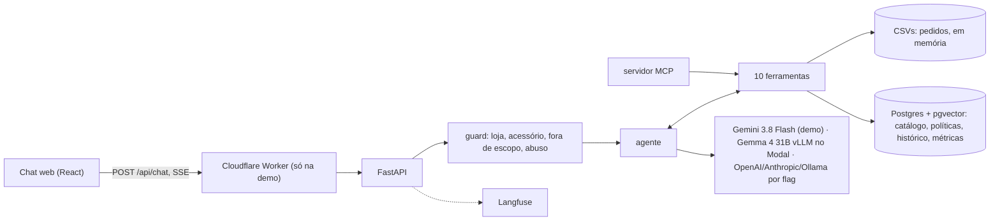

# Empório da Música: agente de atendimento

Um assistente de atendimento para a loja de instrumentos Empório da Música: responde no tom de um vendedor que entende de música, consulta catálogo, promoções e pedidos em ferramentas determinísticas e busca as regras da loja no manual de políticas. Tudo em Python, num chat web que simula o WhatsApp.

**Demo:** https://emporio.fastmind.site (as credenciais foram enviadas por e-mail, fora do repositório).
**Conversas reais da demo:** [catálogo e preço](examples/01-catalogo-e-preco.md), [promoção e parcelamento](examples/02-promocao-e-parcelamento.md), [arrependimento de cliente identificada](examples/03-arrependimento-cliente-identificado.md), [pedido anônimo com verificação](examples/04-pedido-anonimo-com-verificacao.md), [acessório e fora de escopo](examples/05-acessorio-e-fora-de-escopo.md).


Stack: LangGraph + FastAPI, Postgres com pgvector, React, Langfuse; modelo Gemini 3.8 Flash na demo, Gemma 4 31B no Modal a uma flag de distância.

## Como rodar

Pré-requisitos: Docker, [uv](https://docs.astral.sh/uv/), Node ≥ 22.12 e `make`. O Langfuse local pede cerca de 2,3 GB de RAM. Na primeira vez, o `make up` baixa o modelo de embeddings (~470 MB) e as imagens do Langfuse (~7 min).

```bash
cp .env.example .env
make setup        # dependências e hooks de pre-commit
make web-keys     # gera o SESSION_SECRET no .env
```

No `.env`, defina `DEMO_EMAIL` e `DEMO_PASSWORD`: é o login da sua demo local, escolhido por você. As chaves do Langfuse local são geradas sozinhas.

**O caminho mais curto, sem chave nenhuma:** o modelo de teste (roteirizado) sobe o sistema inteiro.

```bash
EMPORIO_FAKE_MODEL=1 make up      # abra http://localhost:8000
```

**Com um modelo de verdade:** ponha no `.env` a chave do provedor (`GEMINI_API_KEY`, `OPENAI_API_KEY` ou `ANTHROPIC_API_KEY`) e escolha o provedor na linha de comando ou em `LLM_PROVIDER`. Se a chave faltar, o `make up` falha em segundos, antes de subir o Docker.

```bash
make up PROVIDER=gemini           # ou openai, anthropic; gemma pede VLLM_BASE_URL e VLLM_API_KEY
```

**Com o modelo na sua máquina:** `make up PROVIDER=local` roda o Gemma 4 pelo [Ollama](https://ollama.com/download) e escolhe o tamanho do modelo pela memória da máquina (no Mac, instale o app do Ollama antes). Tamanhos e tempos estimados em [docs/local-model.md](docs/local-model.md).

Outros comandos úteis:

| Comando | O que faz |
|---|---|
| `make dev` | API com reload em :8000 mais o Vite, pra mexer no código |
| `make chat ARGS="--as-customer 14 --provider gemini"` | o agente no terminal, como a cliente 14 |
| `make mcp` | as ferramentas da loja num servidor MCP (stdio), sem chave de modelo |
| `make check` / `make check-web` | lint, tipos, contratos de import e testes (backend / frontend) |
| `make e2e` | o fluxo no navegador (Playwright) contra um servidor real, com o modelo de teste |
| `make evals PROVIDER=gemini` | os 22 casos de ouro contra o modelo real; gera `backend/evals/reports/<provedor>.md` |

## Arquitetura

O princípio central: **dado estruturado vai por ferramenta determinística; texto vai por RAG.** Preço, estoque, pedido e promoção são consultas exatas (SQL no catálogo, Python nos pedidos) (o próprio manual pede "nunca fornecer preços, estoque ou prazos sem consultar o sistema"); só o manual de políticas passa por busca semântica.



Cada mensagem passa primeiro por um classificador de escopo (o guard) e depois pelo agente, que chama as ferramentas quantas vezes precisar (até 5 voltas). O histórico fica num checkpointer do LangGraph no Postgres. As mesmas dez ferramentas são expostas por MCP, para qualquer outro cliente (Claude Desktop, outro agente).

## Catálogo no Postgres

Os produtos ficam no Postgres, e a busca combina texto, erro de digitação e significado numa consulta só. Na demo, entre e abra **Catálogo** (o back office da loja): cadastre um produto e pergunte por ele no chat. O agente continua só lendo; quem escreve é o usuário logado, e só nos próprios produtos. Com 50 mil produtos, a busca levou de 17 a 34 ms (mediana, testes locais; [pesquisa](docs/research/catalog-db.md), [ADR 0011](docs/decisions/0011-catalog-in-postgres-hybrid-search.md)).

## Domínios e organização

O backend (`backend/src/emporio/`) tem quatro domínios: **catalog** (produtos, estoque, promoções, PIX e parcelamento), **orders** (pedidos, rastreio, identidade, troca e devolução), **policies** (o manual da loja, a busca sobre ele e o horário) e **support** (o agente: persona, guard, grafo, memória, ferramentas e voz).

Cada domínio tem `domain/` (regras puras, sem IO nem framework), `application/` (um caso de uso por arquivo) e `infrastructure/` (CSV, Postgres, provedores de modelo, MCP). O `import-linter` garante essa separação em todo `make check` ([regras completas](AGENTS.md#architecture-rules)).

## Decisões técnicas

| Decisão | Escolha | Por quê | ADR |
|---|---|---|---|
| Dados × políticas | ferramentas para dados, RAG para o manual | preço e prazo não podem ser aproximados | [0001](docs/decisions/0001-tools-vs-rag.md) |
| Framework | LangGraph: guard → agente ⇄ ferramentas | escopo e abuso testáveis fora do prompt | [0007](docs/decisions/0007-langgraph-guard-agent.md) |
| Modelo | Gemma 4 31B no Modal (vLLM, H100 FP8) | a voz mais humana do teste de modelos | [0002](docs/decisions/0002-gemma-no-modal.md) |
| Modelo da demo | Gemini 3.8 Flash | sem cold start de GPU e sem queimar o crédito | [0008](docs/decisions/0008-gemini-hosted-default.md) |
| Provedores | um factory, escolha por flag, sem fallback silencioso | trocar de modelo sem mexer no código | [0006](docs/decisions/0006-provedores-por-flag.md) |
| Recuperação e persistência | um Postgres com pgvector; busca híbrida (vetor + full-text) | um banco só para histórico, métricas e índice | [0003](docs/decisions/0003-postgres-pgvector.md) |
| Embeddings | `multilingual-e5-small` em CPU, embutido na imagem | sem segundo provedor nem chave extra | [0004](docs/decisions/0004-embeddings-locais.md) |
| Interface | chat web que simula o WhatsApp | o avaliador testa em minutos, sem conta de WhatsApp | [0005](docs/decisions/0005-canal-simulado.md) |
| Observabilidade | Langfuse obrigatório, com nomes mascarados | trace de toda resposta, sem vazar cliente | [0009](docs/decisions/0009-langfuse-mandatory.md) |
| Argumentos das ferramentas | schemas Pydantic estritos | argumento errado vira erro recuperável, não preço errado | [0010](docs/decisions/0010-strict-tool-schemas.md) |
| Prompt | persona, voz, regras de ferramenta e guard em pt-BR | regras explícitas de ferramenta pesaram mais que o tamanho do modelo | [prompts](backend/src/emporio/support/infrastructure/agent/prompts/) |

## Como escolhi o modelo

Comparei 9 modelos em 14 cenários do case, com as ferramentas reais, medindo ferramenta certa, fato certo, marcas de IA no texto e naturalidade (nota de 1 a 5):

| Etapa | Resultado |
|---|---|
| Primeira comparação | Gemini 3.8 Flash e Mistral Large 4: 14/14. Gemma 4 31B: 10/14, mas a voz mais humana (4,8) |
| Prompt v2, com regras de ferramenta explícitas | Gemma 4 31B: 14/14 (2 deles só depois de corrigir o verificador) |
| Gemma 4 31B no Modal (GPU H200) | 2,2 s de mediana por resposta |

A lição: regras claras de ferramenta no prompt pesaram mais que o tamanho do modelo. Detalhes em [docs/model-selection.md](docs/model-selection.md).

## Voz humana

A voz é escrita nos prompts ([voice.md](backend/src/emporio/support/infrastructure/agent/prompts/voice.md) e [persona.md](backend/src/emporio/support/infrastructure/agent/prompts/persona.md)): mensagens curtas, uma pergunta por vez e sempre no fim, sem markdown, sem travessão, sem frase pronta de SAC, o primeiro nome do cliente uma vez. A persona é "assistente da Empório", sem nome humano inventado.

A resposta vira até 3 balões curtos, que chegam um depois do outro com "digitando…" na tela, como numa conversa de WhatsApp.

E a voz é medida, não só prometida: [`ai_tells.py`](backend/src/emporio/support/domain/ai_tells.py) marca travessão, markdown, frases banidas, emoji, excesso de exclamação, mais de uma pergunta, pergunta fora do fim, mais de 3 balões e balão longo. Os evals exigem zero marcas.

## Tratamento de dados e armadilhas

A busca de produtos normaliza acento, caixa e plural e tolera erro de digitação com `difflib` ("violuao" acha o violão), separando resultado exato de candidatos: na dúvida, o agente pergunta. Cada armadilha encontrada nos dados virou teste:

| Armadilha | Teste |
|---|---|
| produtos descontinuados, "em breve" e sem estoque não aparecem como disponíveis | `test_discontinued_and_coming_soon_are_unavailable`, `test_unavailable_products_hidden_by_default` |
| só 4 das 25 promoções estão ativas | `test_four_active_promotions` |
| o PIX de 5% não se soma à promoção | `test_pix_price_is_absent_when_promotion_active` |
| "Takamine" sozinho é ambíguo (4 produtos) | `test_takamine_returns_four_candidates` |
| pedido cancelado não pode ser devolvido | `test_cancelled_order_17_is_not_eligible` |
| e-mail de outro cliente não revela o pedido | `test_order_5_with_other_customers_email_is_rejected` |
| erro de digitação no nome do produto | `test_typo_violuao_finds_c40` |

## Premissas

- **Data de referência (`STORE_TODAY`, padrão 20/02/2026):** os pedidos vão de 10/2025 a 03/2026; com a data real, nenhum estaria no prazo de devolução. Essa data deixa pedidos dentro e fora do prazo (o pedido 7 pode ser devolvido por arrependimento, o 5 não). O horário "aberto agora" usa o relógio real de Campo Grande.
- **Parcelamento:** o manual traz parcela mínima de R$ 100 numa tabela e faixas na seção 3.1; vale a 3.1 (R$ 50 de 2 a 3x, R$ 80 de 4 a 6x, R$ 100 de 7 a 12x).
- **Contato:** a capa e a seção 1.2 dão o WhatsApp (67) 3341-4444, e a seção 7 dá (67) 3321-4500; um trecho grafa o e-mail com acento. O agente usa sempre (67) 3341-4444 e contato@emporiodamusica.com.br.
- **Identidade:** quem é o cliente vem do canal (o seletor "conversar como…" na web, `--as-customer` no terminal), nunca de um argumento do modelo. Anônimo só vê um pedido se número e e-mail ou telefone conferirem.
- **"Venda final":** o manual exclui da troca itens de liquidação com aviso de "venda final", mas os dados não marcam nenhuma promoção assim; o sistema não trata compra em promoção como venda final.
- **Feriados:** lista fixa de 2025–2026; o feriado municipal de Campo Grande em 26/08 não foi confirmado.

## Qualidade

- **Testes:** 703 testes determinísticos, sem modelo, escritos antes do código (cada comportamento é um par de commits `test(...) (red)` → `feat(...)` no histórico). O `make check` (ruff, basedpyright, import-linter e pytest) e a varredura de segredos rodam também no CI.
- **Evals:** 22 casos de ouro rodando o grafo real (ferramenta esperada, fato esperado e detector de voz); meta de 90% de acerto e zero marcas de IA. Cada relatório traz as transcrições completas para auditoria.

| Provedor | Acerto | Marcas de IA | Tempo de resposta (mediana / p95) | Observação |
|---|---|---|---|---|
| Gemini 3.8 Flash ([relatório](backend/evals/reports/gemini.md)) | 22/22 | 0 | 6,1 s / 8,0 s | rodada final, no código entregue |
| Gemma 4 31B, H100 FP8 ([relatório](backend/evals/reports/gemma-h100-fp8.md)) | 21/22 | 4 | 2,1 s / 4,1 s | anterior às correções de voz |
| Gemma 4 31B, L40S FP8 ([relatório](backend/evals/reports/gemma-l40s-fp8.md)) | 21/22 (22/22 efetivo) | 0 | 4,9 s / 10,0 s | anterior à versão final do verificador |

Cada linha é uma rodada só. A rodada anterior do Gemini deu 20/22: uma divergência do recomendador (indicou violões de nylon válidos do catálogo, mas não os escolhidos pela ferramenta de recomendação) e uma devolução fora do prazo explicada certo, numa frase que o verificador não reconhecia.

## Escala e custo

- **Cold start:** a meta era 30 s e **não foi atingida**; ligar a GPU do Gemma leva cerca de 3,5 min. Por isso a demo roda no Gemini.
- **Carga:** 120 usuários ao mesmo tempo por 2 minutos, 1.334 conversas e nenhuma falha (com o modelo de teste, medindo a nossa infraestrutura).
- **Custo:** cerca de R$ 0,11 por conversa de 4 turnos no Gemini (estimativa pelo preço de tabela).
- **GPU própria:** uma H100 ligada no horário da loja custa ~US$ 837/mês e passa a compensar a partir de ~42 mil conversas/mês ([contas e projeções](docs/scaling-and-cost.md)).

## Limitações e o que eu faria com mais tempo

- **Latência do Gemini:** mediana de 6,1 s, acima da meta de 3 s. O Gemma numa H100 já ligada fica dentro, mas leva ~3,5 min para ligar ([como reduzir](docs/scaling-and-cost.md#2-cold-start)).
- **Ficou sem medir, pelo orçamento de GPU:** os evals do Gemma depois dos últimos ajustes de voz, o teste de carga com modelo real e os tempos do modo local.
- **Uma instância só:** limites de uso e conversas em andamento ficam na memória do processo; escalar pede movê-los para o Postgres ou um Redis.
- **Detalhes de tela:** recarregar a página apaga os balões (a conversa continua no servidor), e uma troca de cliente que falha não avisa.
- **Com mais tempo:** WhatsApp oficial, passagem para atendente humano, reranking na busca de políticas, cartões de produto nos balões e mais proteção de dados pessoais.

## Uso de assistentes de IA

O projeto foi feito com o Claude Code, sempre na mesma ordem: spec, plano, testes antes do código (TDD), revisão independente e o ok do dono antes da fase seguinte. O contexto do assistente está versionado: [AGENTS.md](AGENTS.md), as regras em [`.claude/rules/`](.claude/rules/) e as skills em [`.claude/skills/`](.claude/skills/). Commits feitos com o assistente levam o trailer `Co-Authored-By`.

O dono tomou as decisões de produto e de custo (busca híbrida nas políticas, guard em todo turno, Langfuse obrigatório, Gemini na demo, evals sem LLM como juiz e os cortes de orçamento de GPU); o assistente escreveu código, testes e rascunhos, e o dono revisou e aprovou cada fase.

## Onde encontrar cada item do enunciado

| Pedido | Onde |
|---|---|
| Projeto em Python | `backend/` (agente, ferramentas, API, evals); TypeScript só no React |
| Persona alinhada à loja | [Voz humana](#voz-humana), [prompts](backend/src/emporio/support/infrastructure/agent/prompts/) |
| Responder com base no contexto e no histórico | [Arquitetura](#arquitetura) |
| Saber quando consultar dados × políticas | [Arquitetura](#arquitetura), [ADR 0001](docs/decisions/0001-tools-vs-rag.md) |
| Lidar com fora de escopo | guard ([ADR 0007](docs/decisions/0007-langgraph-guard-agent.md)), [exemplo 5](examples/05-acessorio-e-fora-de-escopo.md) |
| Decisões justificadas (framework, LLM, recuperação, prompt, interface, persistência, dados) | [Decisões técnicas](#decisões-técnicas), [Tratamento de dados](#tratamento-de-dados-e-armadilhas) |
| Como rodar | [Como rodar](#como-rodar) |
| Limitações e o que faria com mais tempo | [Limitações](#limitações-e-o-que-eu-faria-com-mais-tempo) |
| Uso de assistentes de IA | [Uso de assistentes de IA](#uso-de-assistentes-de-ia) |
| 3 a 5 conversas de exemplo | [`examples/`](examples/) |
| Ambiguidades assumidas e documentadas | [Premissas](#premissas) |
