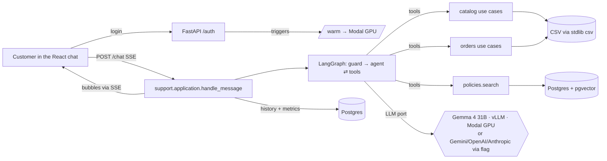

# Design — Artefact Case (AI Engineer): "Empório da Música" support agent

> **Model spike: completed on 05/11.** Full report in `docs/model-selection.md`; the README section "how I chose the model" comes from it.
> - **Round 1 (9 models × 14 scenarios, prompt v1):** Gemini 3.8 Flash and Mistral Large 4 scored 14/14. Gemma 4 31B scored 10/14, with the most human voice (4.8).
> - **Prompt v2 + plural/accent-tolerant search:** Gemma 4 31B reached 14/14. The 2 remaining error marks were false negatives of the verifier.
> - **Gemma 4 31B on Modal (H200, vLLM, app `emporio-gemma`, secret `emporio-vllm`):**
>   - 14/14 and voice 4.7, no AI tells;
>   - median latency of 2.2 s and maximum of 3.9 s, against 7 s and 44 s in the queue of NVIDIA's free API;
>   - cold start of 175 s with the GPU off.
> - **Lessons for the project:**
>   - explicit tool-use rules in the prompt (identified customer → `list_my_orders`; a promotion always with original price, % and final price);
>   - normalized search (plural/accent);
>   - the evals verifier must accept paraphrases ("9 parcelas" = "9x"; "não está mais disponível").

> Status: spec under discussion (brainstorming). After approval, it moves on to the implementation plan (superpowers:writing-plans).
> When the repository exists, this spec is copied to `docs/superpowers/specs/2026-11-05-emporio-agent-design.md` and committed.

## 1. Intent and why
Artefact sent the written case, the 1st of 5 stages of the **AI Engineer – Full-Stack for Generative AI Applications** process, due **Mon 09/11/2026 23:59**.
The statement asks for a support agent in **Python** (mandatory constraint) for a fictional instrument store. The deliverable is:
- a public GitHub repo, with a real commit history;
- a README with decisions, assumptions, limitations and AI usage;
- 3 to 5 example conversations.
They evaluate **"lógica, clareza e iniciativa"** (logic, clarity and initiative), and the e-mail asks for "a forma mais simples possível" (the simplest way possible).

**Quality goal:** demonstrate modern, well-organized agent engineering: clear architecture, measured and justified decisions, code that is easy to navigate.

**Reference stack:** Python, LangChain/LangGraph, MCP, RAG, GCP/Gemini, Docker, CI/CD.

## 2. Goals
1. **Extremely human voice:** the answers read as if written by a store attendant on WhatsApp, not by an AI.
2. **Assertive tools:** the right tool at the right time, without inventing price, stock or lead time, with well-typed and tested tools.
3. **Proven scale and cost:** measured cost per conversation, cost optimization, a scale estimate and a **real serverless deploy on Modal with a load test** against the deploy.
4. **Very clear architecture:**
   - **TDD** visible in the history (test first, then the implementation);
   - **DDD** with clear domains;
   - obvious folders, explicit functions, **SOLID**;
   - code that is easy to navigate.
5. **Agentic development workflow in the repository:**
   - `AGENTS.md` as the main file, and `CLAUDE.md` with a one-line `@AGENTS.md`;
   - per-folder rules in `.claude/rules/` with `paths:`;
   - project **skills** in `.claude/skills/`.
6. **React frontend with a well-defined design system**, built with the **Get Shit Pretty (GSP)** skill in lean mode.

## 3. Non-goals
- **Real WhatsApp integration**, official or via Baileys. The statement only asks for "CLI, notebook, API, or simple UI", and WhatsApp appears only as the store's channel in the PDF. Baileys was ruled out because it is unofficial (it violates the terms and puts the number at risk), because it is Node and because the evaluator could not test it. Meta's official API goes in the README as a next step.
- **Login for the store's customer.** The customer is identified by the channel (see 7.3). The login that exists is only for **demo access**.
- **Spending cap and quota alert.** The access login already protects the key.
- (Removed: running the model locally is now a supported option; see 7.14.)
- Writing store data: the agent reads and does not change orders or stock.
- The full GSP pipeline: market research and launch are left out.

## 4. Anti-goals (a failure even if it "works")
- **Looking too complex for the problem:** every piece needs a written why in the README, with no empty ceremony (an interface with a single implementation for no reason, factories, unused domain events).
- **An answer that looks like AI:** em dash, markdown and bold in chat, "fico feliz em ajudar", "ótima pergunta", lists of three, a summary at the end, a long block.
- **Inventing** price, stock, lead time or rule.
- **Exposing one customer's data** to another person.
- **The evaluator being unable to run it** by following the README.
- **A single commit or a force-push**, or touching the repo after submission.

## 5. Constraints
- Python is the main language. TS only in React. Backend 100% Python.
- **LLM (decision after the spike):** **Gemma 4 31B self-hosted on Modal** (vLLM, H200, OpenAI-compatible, `--enable-auto-tool-choice --tool-call-parser gemma4`) is the **default**. The agent and the guard use the same model (design decision: a single model, simpler to operate).
  - **Alternative providers: Gemini, GPT (OpenAI) and Claude (Anthropic)**, each only with the flag **and** the key defined:
    - `--provider gemini` + `GEMINI_API_KEY`;
    - `--provider openai` + `OPENAI_API_KEY`;
    - `--provider anthropic` + `ANTHROPIC_API_KEY`.
    - **Rules:** without a flag, it uses Gemma. A flag without a key raises a clear error at startup. There is no silent switch; if Gemma is down, the error explains how to use an alternative provider.
    - **Implementation:** a `ChatModelProvider` port in the `support` domain, with 4 thin adapters (vLLM-OpenAI-compatible, Gemini, OpenAI and Anthropic) via `langchain` (`init_chat_model`). It is an interface with a real reason, because it has 4 implementations.
    - **Evals:** `make evals PROVIDER=...` runs the same suite on any provider, and the README carries the spike's comparison table plus the ones that get run.
    - **Default models per provider:** they are a design decision and stay configurable by variable, for example the latest Flash on Gemini and the current mini/Haiku model on OpenAI/Anthropic. Anthropic has no embeddings, which reinforces local embeddings.
  - **Provider-agnostic code:** `ChatOpenAI` with the vLLM `base_url`, or `init_chat_model`.
- **Embeddings (design decision):** a small multilingual model running on CPU inside Python itself (e.g. `intfloat/multilingual-e5-small`, 384 dimensions), with no key or GPU, both at ingestion and at query time. The vectors go to Postgres/pgvector.
- **GPU sizing (mandatory):**
  - **The initial configuration** (H200, 131k context, BF16) is oversized for conversations of about 3k tokens.
  - **What will be measured:** Gemma 4 31B in **FP8**, with `--max-model-len 16384`, on **L40S** and on **H100**.
  - **Selection criteria:** the cheapest GPU that keeps 14/14 on the spike evals, median latency ≤ 3 s and adequate concurrency.
  - **In the README:** the table of cost per hour × latency × hits.
- **Cold start (mandatory to optimize).** Today it is 175 s.
  - **First:** measure the time breakdown (container, weight loading, compilation and CUDA graphs).
  - **Then, measure each optimization applied:**
    1. FP8 (half the weights to load);
    2. 16k context + compilation cache on the volume;
    3. **Modal GPU memory snapshot** (restores with the model already loaded; validate compatibility with vLLM/Gemma 4);
    4. **Warm-up on login:** a successful login triggers `/warm`, which powers on the GPU. Opening the page triggers nothing, so as not to spend GPU on an anonymous visit.
    5. **Clear, explanatory loading screen:** while the GPU comes up, the chat shows a loading state that:
       - **shows which stage it is in**, via polling of `/warm/status`: "ligando a GPU", "carregando o modelo", "pronto";
       - **shows the estimated and elapsed time**;
       - **explains in plain language why it takes long:** the model runs on its own GPU (Gemma 4 31B on Modal) that **shuts off when nobody is using it, to avoid generating cost**, and waking up takes a few seconds;
       - **warns that in production this would not happen:** with the machine on all the time (or during store hours), the answer comes out in about 2 s;
       - **shows the measured numbers**, for example "normalmente 2,2 s por resposta";
       - **unlocks the message field when the model is ready.** If the person has already typed, the message is queued and sent on its own.
       - The text follows the GSP design system and the voice guide: human, without excessive jargon.
  - **Target:** cold start ≤ 30 s, and perceived wait close to zero with the early warm-up.
  - **In the README:** the before and after of each technique.
  - **Documented fallback:** whoever does not want to wait uses `--provider gemini|openai|anthropic`.
  - **GPU on during business hours (`min_containers`):** stays only as an option explained in the README, with the cost calculated, and is not enabled by default.
- **Keys:** the vLLM one (secret `emporio-vllm` on Modal) and those of the optional providers stay only in the local `.env` and in Modal secrets; never in git. The code agent does not copy secrets. Whoever runs locally uses their own key, including the free one.
- **Deploy:** **Modal (serverless)**, with the Python API (FastAPI + LangGraph) also serving the static React build in a single app. Postgres + pgvector lives on Railway, in the owner's existing project (owner decision, phase 3). Modal's free credits must be confirmed before going up.
- **Demo access login:** the user and password live in Modal secrets and in the local `.env`, and **never enter git**. `.gitignore`, the `.env.example` without values and a CI step that looks for secrets (gitleaks or equivalent) guarantee this. The credentials go only in the delivery e-mail and Google Form.
- **Deadline:** about 15h or more available until Monday. Submission is on Mon ~20h, with slack.

## 6. Decisions made
- LangChain + **LangGraph** to orchestrate.
- **Postgres + pgvector** (aligned with the common ecosystem (pgvector/FAISS/Weaviate), a single database, 100% Python backend) for the policy RAG, the history (LangGraph's Postgres checkpointer) and the metrics. Replaces Convex.
- Frontend in **React**.
- **Gemma 4 31B self-hosted on Modal** as the default, chosen by the spike. Gemini only with flag and variable together.
- **Modal** for the serverless deploy, with a demo access login, no spending cap, and a load test against it using a real LLM and the paid key.
- **End-to-end local run flow:** `make up` brings everything up; `make e2e` runs a real conversation from start to finish.
- **Channel:** React chat that looks like a messaging app + CLI. A "conversar como…" selector that simulates the customer's WhatsApp number, with a fallback of order number + e-mail/phone. Channel port ready and official WhatsApp only in the README.
- **Lean GSP:** brand strategy (the store's voice and tone) → identity → design system (tokens) → chat screen → critique (Nielsen + WCAG 2.2 AA) → build.
- **Order:** spec first. After approval, step 1 is creating the repo and running GSP + mockups to choose from, before any screen code.
- `AGENTS.md` as the main file and `CLAUDE.md` importing it, plus skills and per-folder rules. Reason: the common standard is AGENTS.md, and Claude Code reads AGENTS.md as a fallback since 18/09/2026.

## 7. Proposed design

### 7.1 Central principle (README argument)
**Structured data uses a deterministic tool; text uses RAG.**
- Price, stock, order and promotion are exact queries in Python over the CSVs. The policy itself requires: "nunca fornecer preços, estoque ou prazos sem consultar o sistema".
- RAG (pgvector) is kept only for the policy PDF: about 20 chunks, one per section. It sits behind the `PolicyIndex` port, so it scales by swapping the adapter (Vertex AI Vector Search, Weaviate).

### 7.2 Domains (lean DDD)
| Domain | Responsibility | Pure rules (tested without an LLM) |
|---|---|---|
| **catalog** | products, categories, stock, promotions, final price | available only if `active` and stock > 0; only promotions with `is_active=1`; promotional price shown with original + %; PIX 5% off; installments (3.1) |
| **orders** | status, tracking, items, return/withdrawal eligibility | verified identity (order + customer e-mail or phone); withdrawal (arrependimento) within 7 calendar days after receipt; exchange for defect within 30 days; ineligible items |
| **policies** | store manual and semantic search | chunking by numbered section; opening hours and "open now" (America/Campo_Grande time zone) |
| **support** (customer service) | the agent: persona, guard, graph, memory, tools | voice (guide + "AI tell" detector), scope (instruments only; accessories redirected) |

**Layers per domain:**
- `domain/` (entities and pure rules, no LangChain/SQL/IO);
- `application/` (use cases);
- `infrastructure/` (stdlib `csv` repositories, Postgres/pgvector, vLLM and provider adapters, embeddings and MCP).

The agent's tools are a thin layer in `support/` that calls the use cases. A rule in `.claude/rules/` with `paths: **/domain/**` reinforces purity.

### 7.2.1 Phase 2 rulings
- **Stdlib only in the data path:** CSVs are read with the stdlib `csv` module into memory (a few dozen products, about 20 orders); DuckDB is unnecessary at this size and the repository port lets it be swapped later.
- **`difflib` instead of rapidfuzz:** keeps the domain stdlib-only (domain-purity contract); typo tolerance is enough for a catalog this size.
- **Search grading:** a result is Exact only when every remaining query word hits a name token of a single product (fuzzy needs score ≥ 0.9 with no runner-up within 0.05; model codes with digits never match fuzzily); everything else is Candidates and the agent asks. Category words tolerate typos ("violuao", "guitara", "ukelele").
- **Identity:** an unknown order and a wrong e-mail/phone return the same error, so the agent never reveals which order numbers exist.

### 7.3 Architecture
```
React (Vite+TS, GSP design system) ──POST /chat (SSE)──► FastAPI (Python)
        │                                                  │ LangGraph: guard → agent ⇄ tools
        └── bubbles via SSE ◄─────────────────────────────┤ catalog/orders → stdlib csv (in memory)
                                                           ├ policies → pgvector
                                                           └ history/metrics → Postgres
    scripts/ingest_policies.py (Python): PDF → chunks by section → e5 embeddings (CPU) → pgvector
```
- **Graph:** `guard` (Gemma, structured output: loja | acessório | fora_de_escopo | abuso) → `agent` (Gemma + tools, ReAct; tool rules from the spike's prompt v2) → answer.
- **Memory:** LangGraph `thread_id` with a Postgres checkpointer (`langgraph-checkpoint-postgres`), with the history trimmed to the last N messages.
- **Channel port:** `support` exposes `handle_message(channel_identity, text)`, independent of the channel.
  - **Implementations:** web (FastAPI SSE) and CLI. A WhatsApp webhook adapter comes in only if time is left, with tests only.
  - **`channel_identity`:** represents what the channel reports, such as the number on WhatsApp.
  - **On the web:** the "conversar como…" selector picks a customer from the CSV.
  - **On the CLI:** `--as-customer <id>`.
- **Identity in orders:**
  - **With `channel_identity`:** the agent lists and queries **only** that customer's orders, and "me arrependi" works without asking for the order number.
  - **Anonymous:** it asks for the order number and the e-mail or phone, and only shows it if both match.
  - **Never** exposes another customer's data. This is tested.
- **Tools:**
  - `search_products`: accent/plural-normalized token match with `difflib` typo tolerance ("violuao" finds "violão"), category and price-range filters; results are graded Exact/Candidates and ambiguity becomes a question to the customer;
  - `recommend_products` (phase 3): semantic search over product descriptions (e5 + pgvector) for open needs ("algo pra tocar MPB em casa"); returns Candidates only, never an exact match, and prices still come from the catalog;
  - `get_product`;
  - `list_active_promotions`;
  - `calc_installments`: deterministic;
  - `get_order_status`: with identity verification;
  - `check_return_eligibility`;
  - `store_now`;
  - `search_policies`.
- **"Today" (design decision):** the orders run from 10/2025 to 03/2026. With the real date, all of them would be outside the withdrawal window. So `STORE_TODAY` is **mandatory** and defaults to **2026-02-20**, chosen so that there are orders inside and outside the window (order 7 is regret-eligible, order 5 is not). It is documented as an assumption, together with the data quirks: some orders are dated after that day, product #135 is named "Music Man Bass 1X" but described as a Fender Jazz Bass, the installment rules conflict (section 3.1 wins), and a delivered order's delivery date is taken as `estimated_delivery`.

### 7.4 Human voice
- **Voice guide:** lives in `src/support/voice/`, with the tone from section 7.1 of the policy ("informal mas profissional, amigo que entende de música"), good and bad examples taken from the store's own scenarios and the list of AI tells (sources: Wikipedia's "Signs of AI writing" guide and WhatsApp customer-service guides). It feeds the persona prompt and is the same voice defined in the GSP brand strategy stage. The guide and the persona prompts are written in Portuguese (pt-BR); the persona prompt language (PT instructions vs EN instructions with PT examples) will be A/B-tested in the phase 4 evals, with PT as the default.
- **Answer style:**
  - short messages, one question at a time;
  - no markdown, em dash or stock phrases;
  - uses the customer's name when known;
  - 1–3 short bubbles per reply, question last.
- **"AI tell" detector:** a tested function and an evals step that fails an answer with an em dash, markdown, a blacklisted phrase or above the maximum length. The voice becomes measured, not just promised.

### 7.5 Scale and cost
- **Metrics per turn**, stored in Postgres: input and output tokens per model, latency per stage (guard, LLM, tools, vector search) and cost in R$. The frontend shows a discreet panel.
- **Optimizations:**
  - short guard (few tokens, no reasoning);
  - vLLM prefix caching (fixed prompt preprocessed on the GPU), bubble streaming and reasoning off for simple answers;
  - deterministic answers without an LLM for trivial questions (hours, address) when the guard has high confidence;
  - trimmed history;
  - tools returning lean JSON.
- **Scale on Modal:** autoscaling and scale-to-zero. The README shows concurrency per container, measured cold start and infra cost per conversation added to the LLM cost.
- **Load (Locust or k6) against Modal**, authenticated with the demo login, in two modes: (a) a simulated LLM with hundreds of simultaneous conversations, which measures our infra; (b) a real LLM with dozens of conversations, which measures real cost and latency.
- **README:** cost per conversation; projection for 1k, 10k and 100k conversations per month; identified bottleneck (probably: the LLM provider's limit) and how to scale (replicas, queue, quota).

### 7.6 Quality and TDD
- **Deterministic `tests/`** (no LLM), written **before** the code, covering the traps found in the data:
  - 2 `discontinued` products, 1 `coming_soon` and 2 with stock 0;
  - only 4 of 25 promotions active;
  - 4 Takamine (ambiguous search);
  - `cancelled` orders with `notes`;
  - installments;
  - PIX;
  - two phone numbers in the PDF (documented assumption).
- **`evals/`:** about 15 golden cases running the real graph (expected tool + expected fact + voice detector), with a `.md` report of the hit rate. It includes the 4 scenarios from the statement, ambiguous Takamine, order without identity, accessory, out of scope, "tá aberto agora?" and withdrawal inside and outside the window.
- **CI on GitHub Actions:** `ruff`, `mypy` or `pyright`, `pytest` (deterministic only) and the frontend build.

### 7.7 Layered architecture and folder organization

**Flow of a message:**


**Repository tree:**
```
emporio-da-musica-agent/
├── AGENTS.md                      # instructions for coding agents (<200 lines)
├── CLAUDE.md                      # one line: @AGENTS.md
├── README.md
├── Makefile                       # dev · e2e · test · evals · load · warm · deploy · ingest
├── .env.example                   # names only, no values
├── .github/workflows/ci.yml       # ruff · pyright · pytest · gitleaks · front build
├── .claude/
│   ├── rules/                     # domain-purity.md (paths: **/domain/**), tests.md, voice.md, secrets.md
│   └── skills/                    # adding-agent-tool/ · writing-store-voice/ · running-evals/
├── data/                          # original CSVs + PDF, read-only
├── docs/
│   ├── architecture.md            # diagrams (mermaid) and dependency rule
│   ├── decisions/                 # short ADRs: 0001-tools-vs-rag, 0002-gemma-no-modal, 0003-postgres-pgvector,
│   │                              #   0004-embeddings-locais, 0005-canal-simulado, 0006-provedores-por-flag
│   ├── model-selection.md         # the spike: 9 models, prompt v1→v2, Modal vs NVIDIA
│   ├── scaling-and-cost.md        # GPU, cold start before/after, load, cost projection
│   └── superpowers/specs/         # this spec
├── examples/                      # 3–5 real conversations (.md), with the tools executed
├── backend/
│   ├── pyproject.toml             # uv
│   ├── src/emporio/
│   │   ├── shared/                # money.py · text.py (accent/plural normalization) · clock.py (STORE_TODAY)
│   │   ├── catalog/
│   │   │   ├── domain/            # product.py · pricing.py (promo, PIX) · installments.py
│   │   │   ├── application/       # search_products.py · get_product.py · list_promotions.py
│   │   │   └── infrastructure/    # csv_catalog_repository.py
│   │   ├── orders/
│   │   │   ├── domain/            # order.py · identity.py · return_policy.py
│   │   │   ├── application/       # get_order_status.py · list_customer_orders.py · check_return_eligibility.py
│   │   │   └── infrastructure/    # csv_order_repository.py
│   │   ├── policies/
│   │   │   ├── domain/            # policy_chunk.py · store_hours.py
│   │   │   ├── application/       # search_policies.py · ingest_policies.py
│   │   │   └── infrastructure/    # pdf_sections.py · e5_embedder.py · pgvector_policy_index.py
│   │   ├── support/
│   │   │   ├── domain/            # channel_identity.py · bubbles.py · ai_tells.py · scope.py
│   │   │   ├── application/       # handle_message.py (channel port) · ports.py (ChatModelProvider, ConversationStore)
│   │   │   └── infrastructure/
│   │   │       ├── agent/         # graph.py (LangGraph) · tools.py (thin layer over the use cases) · prompts/ (persona, rules, voice guide)
│   │   │       ├── llm/           # vllm.py · gemini.py · openai.py · anthropic.py · factory.py (flag+key rule)
│   │   │       └── postgres_store.py · metrics.py
│   │   ├── api/                   # app.py: /auth/login · /warm · /warm/status · /chat (SSE) · /customers
│   │   ├── cli.py                 # `emporio chat --as-customer 14 --provider gemini`
│   │   └── config.py              # pydantic-settings
│   ├── tests/
│   │   ├── unit/{catalog,orders,policies,support,shared}/   # pure rules, no LLM/IO
│   │   ├── integration/           # adapters (CSV, Postgres/pgvector via docker compose, provider factory)
│   │   └── contract/              # tools: schema and lean JSON output
│   ├── evals/                     # cases.yaml · run.py · judge.py · reports/
│   └── load/                      # locustfile.py (simulated and real LLM)
├── docker-compose.yml             # local Postgres + pgvector
├── backend/migrations/            # SQL schema (alembic or plain SQL, decided in phase 3)
├── frontend/                      # Vite + React + TS, by feature: auth/ · warmup/ · chat/ · design-system/
│   └── .design/                   # GSP artifacts (strategy, identity, tokens, critique)
├── e2e/                           # Playwright: login → warm-up → conversation → bubbles
└── deploy/                        # modal_api.py (CPU) · modal_gemma.py (GPU)
```

**Dependency rule (CI checks it with `import-linter`):**

| Layer | May import |
|---|---|
| `*/domain` | only `shared` and stdlib. No LangChain, SQL, FastAPI or IO |
| `*/application` | the domain's own `domain`, other `application` via port, `shared` |
| `*/infrastructure` | `application`, `domain` and external libs |
| `api/`, `cli.py` | `support.application` and `config` (never another domain's `infrastructure` directly, only via the factory) |

**SOLID in practice, without ceremony:**
- **S:** one use case per file.
- **O and L:** LLM providers come in as new adapters of the same port.
- **I:** small ports (`ChatModelProvider`, `ConversationStore`, `PolicyIndex`).
- **D:** use cases receive repositories through the constructor.
- **Interfaces only where there is more than one real implementation or a test fake.**

**Skills and AGENTS.md follow the official documentation:**
- skills with a 3rd-person description saying when to use them, SKILL.md under 500 lines and references one level down;
- AGENTS.md under 200 lines: commands, conventions, gotchas, without describing folders.

### 7.8 README (structure, mapped to the statement)
1. **Overview in 5 lines**, with a GIF of the conversation and the demo link (credentials sent outside the repo).
2. **How to run:**
   - prerequisites (uv, Node, Make);
   - `.env` from `.env.example`;
   - `make up` (docker compose with Postgres/pgvector + migrations + ingestion + API + front);
   - `make e2e`;
   - model provider: default Gemma on Modal, or `--provider gemini|openai|anthropic` with the matching key;
   - CLI: `make chat`.
3. **Architecture:** the diagram and the central principle "structured data = tool; text = RAG".
4. **Domains and code organization**, with the dependency rule table.
5. **Technical decisions and justifications.** Each row points to an ADR. This is what the statement asks for: framework, LLM, retrieval architecture, prompt strategy, interface, history persistence, data handling.
6. **How I chose the model:** summary of the spike (table), with a link to `docs/model-selection.md`.
7. **Human voice:** voice guide, sequential bubbles, "AI tell" detector and what it measures.
8. **Data handling:** normalization, traps found and how each becomes a test.
9. **Assumptions:**
   - `STORE_TODAY`;
   - installments;
   - the two phone numbers in the PDF;
   - identity by the channel;
   - "venda final" on a promotion.
10. **Quality:** tests, evals (rate per provider) and CI.
11. **Scale and cost:** chosen GPU, cold start before and after, load, cost per conversation and 1k/10k/100k projection.
12. **Known limitations and what I would do with more time:** official WhatsApp, handoff to a human, observability (LangSmith/OTel), PII guardrails, reranking.
13. **Use of AI assistants:** the real flow with Claude Code (spec → plan → TDD → review), AGENTS.md, skills and rules of the repo, and what was a human decision.
14. **Examples:** links to `examples/` (3 to 5 conversations, at least one non-trivial).

### 7.10 Commit and branch conventions
- **Conventional Commits, with the domain as scope:** `test(catalog): …`, `feat(catalog): …`, `refactor(orders): …`, `docs(readme): …`, `chore(repo): …`, `ci: …`, `perf(gemma): …`, `build(deploy): …`.
- **TDD visible in the history:** each behavior produces a pair of commits, `test(x): <behavior> (red)` followed by `feat(x): <behavior>`, and sometimes `refactor(x)`.
- **Message:** subject ≤ 72 characters in the imperative, body with the why when it is not obvious.
- **`Co-Authored-By` trailer** of the AI assistant on commits made with it, consistent with the README's AI-usage section.
- **Branches per milestone** (`feat/catalog`, `feat/agent`, `feat/web`…), with a described PR and a **merge commit, no squash**, to preserve the history. No force-push on `main`.
- **Tag `v1.0-entrega`** on the submitted commit. After the deadline, no changes.

### 7.11 Statement checklist (each item → where it is met)
| Request in the statement | Where |
|---|---|
| Project in Python (mandatory constraint) | `backend/` (agent, tools, ingestion, API, evals); TS only in React |
| Persona aligned with the store | voice guide + persona prompt (`support/infrastructure/agent/prompts/`) |
| Receive and answer messages based on context | `handle_message` + memory in Postgres (LangGraph checkpointer) |
| Know when to query data × policies | exact tools × `search_policies` (RAG), ADR 0001 |
| Handle out of scope | `guard` node + accessory rules |
| Justified decisions: framework, model/provider, interface, persistence, data handling | README §5 + ADRs |
| Public repo, commits with real progress, no force-push, no change after the deadline | §7.10, tag `v1.0-entrega` |
| README: how to run (environment, provider, commands) | README §2 |
| README: justifications (framework, LLM, retrieval, prompt) | README §5–7 |
| README: limitations + what I would do with more time | README §12 |
| README: use of AI assistants and workflow | README §13 |
| 3–5 conversations (.md/.txt/image), ≥1 non-trivial | `examples/` (catalog, price, address, identified withdrawal, out of scope) |
| Ambiguities: assume and document | README §9 |
| Delivery per the process e-mail instructions: form + reply with the link | Mon 09/11 by ~20h |

### 7.12 Alignment with the agent ecosystem (research of 05/11)
These enter the project (FastAPI + Pydantic remains the web base):
1. **MCP server for the store's tools:**
   - **Where:** `support/infrastructure/mcp/server.py` with FastMCP. It exposes the catalog, orders and policies use cases as MCP tools.
   - **Consumption:** the LangGraph agent uses these tools via `langchain-mcp-adapters`. The `tools.py` layer stays thin over the same contract.
   - **In the README:** the same tools serve any MCP client (Claude Desktop, another agent), and there is a contract test.
   - **Identity:** it is injected by the server, never comes from the model's argument. This prevents the LLM from forging the `customer_id`.
2. **Observability with Langfuse:** tracing of each turn (guard, agent, tools, latency, tokens, cost), with the `trace_id` linked to the message in Postgres.
   - **Configuration:** optional by variable. Without the keys, tracing is turned off without an error.
   - **In the README:** screenshots of a trace.
3. **Engineering hygiene to the ecosystem standard:**
   - `uv`, `ruff` (lint + format) and `pyright`;
   - **pre-commit** with ruff, gitleaks and basic checks;
   - **Dockerfile** for the API, also used by Modal;
   - Pydantic in all contracts.

### 7.13 Language policy and git flow
- **English:** code, identifiers, commits, PRs, `AGENTS.md`, skills, rules and all engineering docs (`docs/**`: spec, plans, research, ADRs, model selection, scaling and cost) and `.design/` artifacts. This is the market standard for a global company.
- **Portuguese (pt-BR):** `README.md`, `examples/` (customer conversations) and everything the store's customer reads or that shapes the agent's Portuguese speech: agent responses, the voice guide and the persona prompts. The statement and the evaluators are Brazilian. The persona prompt language will be A/B-tested in the phase 4 evals (PT instructions vs EN instructions with PT examples); the default is PT.
- **The agent answers in Brazilian Portuguese.**
- **PRs per milestone** (`feat/catalog`, `feat/orders`, `feat/policies-rag`, `feat/agent`, `feat/mcp`, `feat/web`, `feat/deploy`, `docs/readme`), with a short description and a merge commit without squash. It shows organization and preserves the TDD in the history.

### 7.14 Hosted by default, runnable locally with one command
- **Main path: hosted.** Demo on Modal, with login, Python API on CPU and Gemma 4 31B on the GPU. The evaluator just opens the link.
- **`make up` brings everything up locally with one command:**
  - **What comes up:** `docker compose` with Postgres + pgvector, migrations, policy ingestion, API (FastAPI) and frontend.
  - **Default model:** **Gemma hosted on Modal**. The endpoint URL and key go along with the demo credentials in the delivery e-mail and Form, never in git.
  - **Before starting:** the script checks the prerequisites (Docker, uv, Node) and prints what is going to happen.
- **`make up PROVIDER=local` runs the model on the machine itself via Ollama:**
  - **Hardware detection** (design decision):
    - with an NVIDIA GPU, it uses Ollama in Docker with GPU;
    - on an Apple Silicon Mac, it uses **native Ollama** (Metal), because Docker on Mac cannot access the GPU;
    - CPU only: Docker on CPU.
  - **Automatic size:** Gemma 4 31B with a GPU or a Mac with 32 GB or more; a smaller Gemma 4 variant in the other cases. The script reports which one it chose. The quality of the smaller variant is measured in the phase 4 evals and goes into the README table.
  - **Explicit warnings in three places:**
    1. in the terminal, before downloading (download size, memory required, expected time per answer);
    2. in the README, with the hardware × expected time table and the recommendation "for answers in ~2 s, use the hosted one";
    3. on the chat loading screen: "o modelo está rodando na sua máquina sem GPU; cada resposta pode levar de 30 s a alguns minutos".
- **`make up PROVIDER=gemini|openai|anthropic`:** uses the provider's API, requires the matching key and fails early if it is missing.
- **`make e2e`** runs the complete flow against any of these modes.
- **Phase 0 and phase 6 research:** Ollama (available Gemma 4 models, GPU in Docker, Metal on Mac), hardware detection in the script, `docker compose` profiles.

### 7.9 Execution in phases
**Cycle of each phase:**
1. **Internet research:** official documentation and current version of each lib or service in the phase, plus best practices and known pitfalls. The result goes to `docs/research/<phase>.md`, with sources.
2. **Phase plan:** superpowers:writing-plans, only for that phase, already with what the research changed.
3. **Implementation in TDD:** red → green → refactor, one PR per phase.
4. **Review:** tests, lint, evals when there are any, and code review.
5. **Checkpoint:** what was done, a short demo and what changes for the next phase. **The next phase only starts with the owner's ok.**

| Phase | Deliverable | Mandatory research (current docs) | When |
|---|---|---|---|
| **0. Foundation** | repo, AGENTS.md/CLAUDE.md, `.claude/rules` and skills, uv + ruff + pyright + pre-commit + gitleaks, CI, Makefile, `data/`, spec and ADR 0001 committed | AGENTS.md and skills (Anthropic docs), uv, ruff, pre-commit, gitleaks, import-linter, GitHub Actions | Thu 05/11 night |
| **1. Design** | lean GSP (voice strategy → identity → tokens), mockups to choose from (login, warm-up, chat with bubbles), WCAG critique | GSP, messaging-app-style chat UI patterns, UX of long, explanatory loading | Thu night / Fri morning |
| **2. Pure domains** | catalog, orders and `shared` (domain + application + stdlib `csv` repositories), all the data traps as tests | DDD in Python (layout, import-linter), stdlib csv/difflib, PT-BR normalization | Fri 06/11 |
| **3. Policy RAG** | chunking by section, e5 embeddings on CPU, schema and migrations, pgvector (HNSW index), ingestion, local docker compose | pgvector (indexes, cosine distance), psycopg 3 or SQLAlchemy, LangGraph's Postgres checkpointer, Railway Postgres (pgvector, public TCP proxy + SSL), multilingual-e5 (query/passage prefixes), PDF extraction | Fri 06/11 |
| **4. Agent** | MCP server for the tools, LangGraph graph (guard → agent ⇄ tools), provider port (Gemma/vLLM, Gemini, OpenAI, Anthropic), voice + bubbles + detector, evals | FastMCP and langchain-mcp-adapters, LangGraph (current API), vLLM + Gemma 4 tool parser, init_chat_model of the 4 providers, structured output | Sat 07/11 |
| **5. API + Frontend** | FastAPI (demo login, `/warm` and `/warm/status`, `/chat` SSE), React with design system (login → warm-up screen → chat with bubbles and "digitando…"), `make up` and `make e2e` (Playwright) | SSE in FastAPI, simple secure auth, SSE in React (EventSource/fetch stream), Playwright | Sat 07/11 night / Sun 08/11 |
| **6. GPU, deploy and scale** | Gemma FP8/16k on L40S × H100 (cost × latency × evals), measured and optimized cold start (snapshot, cache), API deploy on Modal, Langfuse, load test | Modal (GPU memory snapshots, web endpoints, secrets), vLLM FP8 for Gemma 4, Langfuse SDK, Locust | Sun 08/11 |
| **7. Delivery** | complete README, ADRs, `model-selection.md`, `scaling-and-cost.md`, 3 to 5 real examples, clean clone, tag `v1.0-entrega`, submission via the Form and by replying to the e-mail | README and ADR best practices | Mon 09/11 by ~20h |

**Cut if running late, in this order:** load with a real LLM, metrics panel in the frontend, Langfuse, GPU memory snapshot. The core (phases 0, 2, 3, 4, 5 + deploy + README + examples) is not cut.

## 8. Left to whoever builds it
Lib versions; internal names; Locust or k6; fine chunking inside each section; exact format of the metrics panel; internal structure of the tests.

## 9. Open points
- Repository name.

## 10. Verification
- `pytest` green, with the data and rule traps.
- Evals with a rate ≥ 90% and 0 failures on the voice detector.
- Clean clone following only the README: `make up` brings everything up and `make e2e` passes.
- Deploy on Modal behind the login, answering, with the load test run and the numbers in the README.
- Clean secret scan (`gitleaks`), and no credential in the git history.
- `git log` with spaced-out commits showing the TDD (test → implementation).
- After submission: do not touch the repo anymore.
