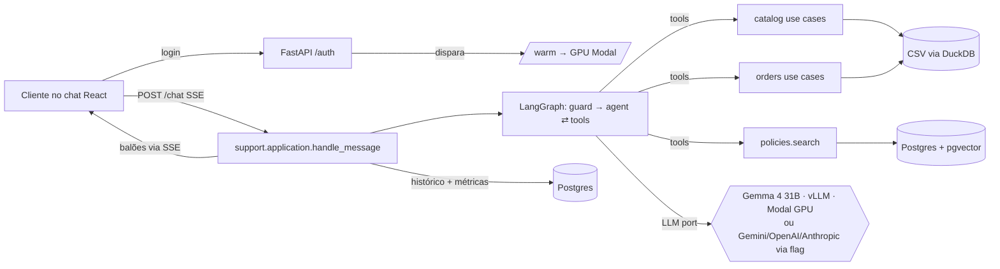

# Design — Case Artefact (AI Engineer): agente de atendimento "Empório da Música"

> **Spike de modelos: concluído em 05/11.** Relatório completo em `docs/model-selection.md`; a seção "como escolhi o modelo" do README sai dele.
> - **1ª rodada (9 modelos × 14 cenários, prompt v1):** Gemini 3.8 Flash e Mistral Large 4 acertaram 14/14. Gemma 4 31B acertou 10/14, com a voz mais humana (4,8).
> - **Prompt v2 + busca tolerante a plural/acento:** Gemma 4 31B chegou a 14/14. As 2 marcações de erro restantes eram falsos negativos do verificador.
> - **Gemma 4 31B no Modal (H200, vLLM, app `emporio-gemma`, secret `emporio-vllm`):**
>   - 14/14 e voz 4,7, sem sinais de IA;
>   - latência mediana de 2,2 s e máxima de 3,9 s, contra 7 s e 44 s na fila da API gratuita da NVIDIA;
>   - cold start de 175 s com a GPU desligada.
> - **Lições para o projeto:**
>   - regras explícitas de uso de tool no prompt (cliente identificado → `list_my_orders`; promoção sempre com preço original, % e preço final);
>   - busca normalizada (plural/acento);
>   - o verificador das evals precisa aceitar paráfrases ("9 parcelas" = "9x"; "não está mais disponível").

> Status: spec em discussão (brainstorming). Depois da aprovação, segue para o plano de implementação (superpowers:writing-plans).
> Quando o repositório existir, esta spec é copiada para `docs/superpowers/specs/2026-11-05-emporio-agent-design.md` e commitada.

## 1. Intenção e porquê
A Artefact mandou o case escrito, a 1ª de 5 etapas do processo **AI Engineer – Full-Stack para Aplicações com IA Generativa**, com prazo até **seg 09/11/2026 23:59**.
O enunciado pede um agente de atendimento em **Python** (restrição obrigatória) para uma loja fictícia de instrumentos. A entrega é:
- repo GitHub público, com histórico de commits real;
- README com decisões, suposições, limitações e uso de IA;
- 3 a 5 conversas de exemplo.
Eles avaliam **lógica, clareza e iniciativa**, e o e-mail pede "a forma mais simples possível".

**Objetivo de qualidade:** demonstrar engenharia de agentes moderna e organizada: arquitetura clara, decisões medidas e justificadas, código fácil de navegar.

**Stack de referência:** Python, LangChain/LangGraph, MCP, RAG, GCP/Gemini, Docker, CI/CD.

## 2. Objetivos
1. **Voz extremamente humana:** as respostas parecem escritas por um atendente de loja no WhatsApp, não por IA.
2. **Tools assertivas:** a ferramenta certa na hora certa, sem inventar preço, estoque ou prazo, com tools bem tipadas e testadas.
3. **Escala e custo provados:** custo por conversa medido, otimização de custo, estimativa de escala e **deploy serverless real no Modal com teste de carga** contra o deploy.
4. **Arquitetura muito clara:**
   - **TDD** visível no histórico (teste antes, depois a implementação);
   - **DDD** com domínios claros;
   - pastas óbvias, funções explícitas, **SOLID**;
   - código fácil de navegar.
5. **Fluxo de desenvolvimento agêntico no repositório:**
   - `AGENTS.md` como arquivo principal, e `CLAUDE.md` com uma linha `@AGENTS.md`;
   - regras por pasta em `.claude/rules/` com `paths:`;
   - **skills** do projeto em `.claude/skills/`.
6. **Frontend React com design system bem definido**, feito com a skill **Get Shit Pretty (GSP)** no modo enxuto.

## 3. Não-objetivos
- **Integração real com WhatsApp**, oficial ou via Baileys. O enunciado só pede "CLI, notebook, API, ou UI simples", e o WhatsApp aparece apenas como canal da loja no PDF. O Baileys foi descartado por ser não oficial (viola os termos e arrisca o número), por ser Node e porque o avaliador não conseguiria testar. A API oficial da Meta fica no README como próximo passo.
- **Login do cliente da loja.** O cliente é identificado pelo canal (ver 7.3). O login que existe é só o de **acesso à demo**.
- **Teto de gasto e alerta de cota.** O login de acesso já protege a chave.
- (Removido: rodar o modelo localmente agora é opção suportada; ver 7.14.)
- Escrita de dados da loja: o agente consulta e não altera pedidos nem estoque.
- Pipeline completo do GSP: ficam de fora a pesquisa de mercado e o launch.

## 4. Anti-objetivos (falha mesmo se "funcionar")
- **Parecer complexo demais para o problema:** toda peça precisa ter um porquê escrito no README, sem cerimônia vazia (interface com uma implementação só sem motivo, fábricas, eventos de domínio sem uso).
- **Resposta com cara de IA:** travessão, markdown e negrito no chat, "fico feliz em ajudar", "ótima pergunta", listas de três, resumo no fim, bloco longo.
- **Inventar** preço, estoque, prazo ou regra.
- **Expor dados de um cliente** para outra pessoa.
- **Quem avalia não conseguir rodar** seguindo o README.
- **Commit único ou force-push**, ou mexer no repo depois do envio.

## 5. Restrições
- Python é a linguagem principal. TS só no React. Backend 100% Python.
- **LLM (decisão após o spike):** **Gemma 4 31B self-hosted no Modal** (vLLM, H200, OpenAI-compatível, `--enable-auto-tool-choice --tool-call-parser gemma4`) é o **padrão**. O agente e o guard usam o mesmo modelo (decisão de design: um modelo só, mais simples de operar).
  - **Provedores alternativos: Gemini, GPT (OpenAI) e Claude (Anthropic)**, cada um só com a flag **e** a chave definidas:
    - `--provider gemini` + `GEMINI_API_KEY`;
    - `--provider openai` + `OPENAI_API_KEY`;
    - `--provider anthropic` + `ANTHROPIC_API_KEY`.
    - **Regras:** sem flag, usa o Gemma. Flag sem chave gera um erro claro na inicialização. Não há troca silenciosa; se o Gemma estiver fora do ar, o erro explica como usar um provedor alternativo.
    - **Implementação:** uma porta `ChatModelProvider` no domínio `support`, com 4 adaptadores finos (vLLM-OpenAI-compatível, Gemini, OpenAI e Anthropic) via `langchain` (`init_chat_model`). É uma interface com motivo real, porque tem 4 implementações.
    - **Evals:** `make evals PROVIDER=...` roda o mesmo conjunto em qualquer provedor, e o README traz a tabela comparativa do spike mais as que forem rodadas.
    - **Modelos padrão por provedor:** são decisão de design e ficam configuráveis por variável, por exemplo o Flash mais recente no Gemini e o modelo mini/Haiku atual na OpenAI/Anthropic. A Anthropic não tem embeddings, o que reforça os embeddings locais.
  - **Código agnóstico de provedor:** `ChatOpenAI` com `base_url` do vLLM, ou `init_chat_model`.
- **Embeddings (decisão de design):** um modelo pequeno e multilíngue rodando em CPU no próprio Python (ex.: `intfloat/multilingual-e5-small`, 384 dimensões), sem chave nem GPU, tanto na ingestão quanto na consulta. Os vetores vão para o Postgres/pgvector.
- **Dimensionamento da GPU (obrigatório):**
  - **A configuração inicial** (H200, contexto de 131 mil, BF16) é superdimensionada para conversas de cerca de 3 mil tokens.
  - **O que vai ser medido:** Gemma 4 31B em **FP8**, com `--max-model-len 16384`, em **L40S** e em **H100**.
  - **Critérios de escolha:** a GPU mais barata que mantenha 14/14 nas evals do spike, latência mediana ≤ 3 s e concorrência adequada.
  - **No README:** a tabela de custo por hora × latência × acertos.
- **Cold start (obrigatório otimizar).** Hoje são 175 s.
  - **Primeiro:** medir a quebra do tempo (container, carga dos pesos, compilação e gráficos CUDA).
  - **Depois, medir cada otimização aplicada:**
    1. FP8 (metade dos pesos para carregar);
    2. contexto de 16 mil + cache de compilação no volume;
    3. **GPU memory snapshot do Modal** (restaura com o modelo já carregado; validar compatibilidade com o vLLM/Gemma 4);
    4. **Aquecimento ao logar:** o login bem-sucedido dispara `/warm`, que liga a GPU. A tela de abrir a página não dispara nada, para não gastar GPU com visita anônima.
    5. **Tela de carregamento clara e explicativa:** enquanto a GPU sobe, o chat mostra um estado de carregamento que:
       - **mostra em que etapa está**, via polling de `/warm/status`: "ligando a GPU", "carregando o modelo", "pronto";
       - **mostra o tempo estimado e o decorrido**;
       - **explica em linguagem simples por que demora:** o modelo roda numa GPU própria (Gemma 4 31B no Modal) que **desliga quando ninguém usa, para não gerar custo**, e acordar leva alguns segundos;
       - **avisa que em produção isso não aconteceria:** com a máquina ligada o tempo todo (ou no horário da loja), a resposta sai em cerca de 2 s;
       - **mostra os números medidos**, por exemplo "normalmente 2,2 s por resposta";
       - **libera o campo de mensagem quando o modelo fica pronto.** Se a pessoa já tiver digitado, a mensagem fica na fila e é enviada sozinha.
       - O texto segue o design system do GSP e o guia de voz: humano, sem jargão excessivo.
  - **Meta:** cold start ≤ 30 s, e espera percebida perto de zero com o aquecimento antecipado.
  - **No README:** o antes e depois de cada técnica.
  - **Fallback documentado:** quem não quiser esperar usa `--provider gemini|openai|anthropic`.
  - **GPU ligada no horário comercial (`min_containers`):** fica só como opção explicada no README, com custo calculado, e não é ativada por padrão.
- **Chaves:** a do vLLM (secret `emporio-vllm` no Modal) e as dos provedores opcionais ficam só no `.env` local e nos secrets do Modal; nunca no git. O agente de código não copia segredos. Quem roda localmente usa a própria chave, inclusive a gratuita.
- **Deploy:** **Modal (serverless)**, com a API Python (FastAPI + LangGraph) servindo também o build estático do React num app só. O Postgres + pgvector fica num serviço gerenciado gratuito (Neon ou Supabase, escolhido na pesquisa da fase 3). Os créditos gratuitos do Modal precisam ser confirmados antes de subir.
- **Login de acesso à demo:** o usuário e a senha ficam em secrets do Modal e no `.env` local, e **nunca entram no git**. O `.gitignore`, o `.env.example` sem valores e um passo de CI que procura segredos (gitleaks ou equivalente) garantem isso. As credenciais vão só no e-mail e no Google Forms da entrega.
- **Prazo:** cerca de 15h ou mais disponíveis até segunda. O envio fica para seg ~20h, com folga.

## 6. Decisões tomadas
- LangChain + **LangGraph** para orquestrar.
- **Postgres + pgvector** (alinhado ao ecossistema comum (pgvector/FAISS/Weaviate), um banco só, backend 100% Python) para o RAG das políticas, o histórico (checkpointer Postgres do LangGraph) e as métricas. Substitui o Convex.
- Frontend em **React**.
- **Gemma 4 31B self-hosted no Modal** como padrão, escolhido pelo spike. Gemini só com flag e variável juntas.
- **Modal** para o deploy serverless, com login de acesso à demo, sem teto de gasto, e teste de carga contra ele usando LLM real e a chave paga.
- **Fluxo de execução local ponta a ponta:** `make up` sobe tudo; `make e2e` roda uma conversa real do início ao fim.
- **Canal:** chat React com cara de app de mensagem + CLI. Seletor "conversar como…" que simula o número do WhatsApp do cliente, com fallback de número do pedido + e-mail/telefone. Porta de canal pronta e WhatsApp oficial só no README.
- **GSP enxuto:** estratégia de marca (voz e tom da loja) → identidade → design system (tokens) → tela do chat → crítica (Nielsen + WCAG 2.2 AA) → build.
- **Ordem:** spec primeiro. Depois da aprovação, a 1ª etapa é criar o repo e rodar GSP + mockups para escolha, antes de qualquer código de tela.
- `AGENTS.md` principal e `CLAUDE.md` importando, além de skills e regras por pasta. Motivo: o padrão comum é o AGENTS.md, e o Claude Code lê AGENTS.md como fallback desde 18/09/2026.

## 7. Desenho proposto

### 7.1 Princípio central (argumento do README)
**Dado estruturado usa ferramenta determinística; texto usa RAG.**
- Preço, estoque, pedido e promoção são consultas exatas em Python sobre os CSVs. A própria política exige: "nunca fornecer preços, estoque ou prazos sem consultar o sistema".
- O RAG (pgvector) fica só para o PDF de políticas: cerca de 20 trechos, um por seção. Fica atrás da porta `PolicyIndex`, para escalar trocando o adaptador (Vertex AI Vector Search, Weaviate).

### 7.2 Domínios (DDD enxuto)
| Domínio | Responsabilidade | Regras puras (testadas sem LLM) |
|---|---|---|
| **catalog** | produtos, categorias, estoque, promoções, preço final | disponível só se `active` e estoque > 0; só promoção `is_active=1`; preço promocional mostrado com original + %; PIX 5% off; parcelamento (3.1) |
| **orders** | status, rastreio, itens, elegibilidade de troca/arrependimento | identidade verificada (pedido + e-mail ou telefone do cliente); arrependimento em 7 dias corridos após o recebimento; troca por defeito em 30 dias; itens não elegíveis |
| **policies** | manual da loja e busca semântica | chunking por seção numerada; horário de funcionamento e "aberto agora" (fuso America/Campo_Grande) |
| **support** (atendimento) | o agente: persona, guard, grafo, memória, tools | voz (guia + detector de "cara de IA"), escopo (só instrumentos; acessórios redirecionados) |

**Camadas por domínio:**
- `domain/` (entidades e regras puras, sem LangChain/SQL/IO);
- `application/` (casos de uso);
- `infrastructure/` (adaptadores DuckDB-CSV, Postgres/pgvector, vLLM e provedores, embeddings e MCP).

As tools do agente são uma camada fina em `support/` que chama os casos de uso. Uma regra em `.claude/rules/` com `paths: **/domain/**` reforça a pureza.

### 7.3 Arquitetura
```
React (Vite+TS, design system GSP) ──POST /chat (SSE)──► FastAPI (Python)
        │                                                  │ LangGraph: guard → agent ⇄ tools
        └── balões via SSE ◄──────────────────────────────┤ catalog/orders → DuckDB (CSVs tratados)
                                                           ├ policies → pgvector
                                                           └ histórico/métricas → Postgres
    scripts/ingest_policies.py (Python): PDF → chunks por seção → embeddings e5 (CPU) → pgvector
```
- **Grafo:** `guard` (Gemma, saída estruturada: loja | acessório | fora_de_escopo | abuso) → `agent` (Gemma + tools, ReAct; regras de tool do prompt v2 do spike) → resposta.
- **Memória:** `thread_id` do LangGraph com checkpointer Postgres (`langgraph-checkpoint-postgres`), com o histórico cortado nas últimas N mensagens.
- **Porta de canal:** `support` expõe `handle_message(channel_identity, text)`, independente do canal.
  - **Implementações:** web (FastAPI SSE) e CLI. Um adaptador de webhook do WhatsApp entra só se sobrar tempo, apenas com testes.
  - **`channel_identity`:** representa o que o canal informa, como o número no WhatsApp.
  - **Na web:** o seletor "conversar como…" escolhe um cliente do CSV.
  - **Na CLI:** `--as-customer <id>`.
- **Identidade nos pedidos:**
  - **Com `channel_identity`:** o agente lista e consulta **só** os pedidos daquele cliente, e "me arrependi" funciona sem pedir o número do pedido.
  - **Anônimo:** pede o número do pedido e o e-mail ou telefone, e só mostra se os dois baterem.
  - **Nunca** expõe dados de outro cliente. Isso é testado.
- **Tools:**
  - `search_products`: fuzzy com `rapidfuzz`, filtros de categoria e faixa de preço, ambiguidade vira pergunta ao cliente;
  - `get_product`;
  - `list_active_promotions`;
  - `calc_installments`: determinística;
  - `get_order_status`: com verificação de identidade;
  - `check_return_eligibility`;
  - `store_now`;
  - `search_policies`.
- **"Hoje" (decisão de design):** os pedidos vão de 10/2025 a 03/2026. Com a data real, todos estariam fora do prazo de arrependimento. Por isso `STORE_TODAY` é **obrigatório** e tem como padrão uma data próxima de 03/2026, escolhida para que existam pedidos dentro e fora do prazo. Fica documentado como suposição.

### 7.4 Voz humana
- **Guia de voz:** fica em `src/support/voice/`, com o tom da seção 7.1 da política ("informal mas profissional, amigo que entende de música"), exemplos bons e ruins dos próprios cenários da loja e a lista de sinais de IA (fontes: guia "Signs of AI writing" da Wikipedia e guias de atendimento por WhatsApp). Ele alimenta o prompt da persona e é a mesma voz definida na etapa de estratégia de marca do GSP.
- **Estilo das respostas:**
  - mensagens curtas, uma pergunta por vez;
  - sem markdown, travessão ou frases feitas;
  - usa o nome do cliente quando souber;
  - pode quebrar a resposta em 2 balões.
- **Detector de "cara de IA":** uma função testada e uma etapa nas avaliações que reprova resposta com travessão, markdown, frase da lista negra ou acima do tamanho máximo. A voz passa a ser medida, não só prometida.

### 7.5 Escala e custo
- **Métricas por turno**, gravadas no Postgres: tokens de entrada e saída por modelo, latência por etapa (guard, LLM, tools, busca vetorial) e custo em R$. O frontend mostra um painel discreto.
- **Otimizações:**
  - guard curto (poucos tokens, sem reasoning);
  - prefix caching do vLLM (prompt fixo pré-processado na GPU), streaming dos balões e reasoning desligado nas respostas simples;
  - respostas determinísticas sem LLM para perguntas triviais (horário, endereço) quando o guard tiver alta confiança;
  - histórico cortado;
  - tools retornando JSON enxuto.
- **Escala no Modal:** autoscaling e scale-to-zero. O README mostra concorrência por container, cold start medido e custo de infra por conversa somado ao custo do LLM.
- **Carga (Locust ou k6) contra o Modal**, autenticada com o login da demo, em dois modos: (a) LLM simulado com centenas de conversas simultâneas, que mede a nossa infra; (b) LLM real com dezenas de conversas, que mede custo e latência reais.
- **README:** custo por conversa; projeção para 1k, 10k e 100k conversas por mês; gargalo identificado (provável: limite do provedor de LLM) e como escalar (réplicas, fila, cota).

### 7.6 Qualidade e TDD
- **`tests/` determinísticos** (sem LLM), escritos **antes** do código, cobrindo as armadilhas encontradas nos dados:
  - 2 produtos `discontinued`, 1 `coming_soon` e 2 com estoque 0;
  - só 4 de 25 promoções ativas;
  - 4 Takamine (busca ambígua);
  - pedidos `cancelled` com `notes`;
  - parcelamento;
  - PIX;
  - dois telefones no PDF (suposição documentada).
- **`evals/`:** cerca de 15 casos dourados rodando o grafo real (tool esperada + fato esperado + detector de voz), com relatório `.md` da taxa de acerto. Inclui os 4 cenários do enunciado, Takamine ambíguo, pedido sem identidade, acessório, fora de escopo, "tá aberto agora?" e arrependimento dentro e fora do prazo.
- **CI no GitHub Actions:** `ruff`, `mypy` ou `pyright`, `pytest` (só os determinísticos) e build do frontend.

### 7.7 Arquitetura em camadas e organização das pastas

**Fluxo de uma mensagem:**


**Árvore do repositório:**
```
emporio-da-musica-agent/
├── AGENTS.md                      # instruções para agentes de código (<200 linhas)
├── CLAUDE.md                      # uma linha: @AGENTS.md
├── README.md
├── Makefile                       # dev · e2e · test · evals · load · warm · deploy · ingest
├── .env.example                   # só nomes, sem valores
├── .github/workflows/ci.yml       # ruff · pyright · pytest · gitleaks · build do front
├── .claude/
│   ├── rules/                     # domain-purity.md (paths: **/domain/**), tests.md, voice.md, secrets.md
│   └── skills/                    # adding-agent-tool/ · writing-store-voice/ · running-evals/
├── data/                          # CSVs + PDF originais, somente leitura
├── docs/
│   ├── architecture.md            # diagramas (mermaid) e regra de dependências
│   ├── decisions/                 # ADRs curtos: 0001-tools-vs-rag, 0002-gemma-no-modal, 0003-postgres-pgvector,
│   │                              #   0004-embeddings-locais, 0005-canal-simulado, 0006-provedores-por-flag
│   ├── model-selection.md         # o spike: 9 modelos, prompt v1→v2, Modal vs NVIDIA
│   ├── scaling-and-cost.md        # GPU, cold start antes/depois, carga, projeção de custo
│   └── superpowers/specs/         # esta spec
├── examples/                      # 3–5 conversas reais (.md), com tools executadas
├── backend/
│   ├── pyproject.toml             # uv
│   ├── src/emporio/
│   │   ├── shared/                # money.py · text.py (normalização acento/plural) · clock.py (STORE_TODAY)
│   │   ├── catalog/
│   │   │   ├── domain/            # product.py · pricing.py (promo, PIX) · installments.py
│   │   │   ├── application/       # search_products.py · get_product.py · list_promotions.py
│   │   │   └── infrastructure/    # csv_catalog_repository.py
│   │   ├── orders/
│   │   │   ├── domain/            # order.py · identity.py · return_policy.py
│   │   │   ├── application/       # get_order_status.py · list_customer_orders.py · check_return_eligibility.py
│   │   │   └── infrastructure/    # csv_order_repository.py
│   │   ├── policies/
│   │   │   ├── domain/            # policy_chunk.py · store_hours.py
│   │   │   ├── application/       # search_policies.py · ingest_policies.py
│   │   │   └── infrastructure/    # pdf_sections.py · e5_embedder.py · pgvector_policy_index.py
│   │   ├── support/
│   │   │   ├── domain/            # channel_identity.py · bubbles.py · ai_tells.py · scope.py
│   │   │   ├── application/       # handle_message.py (porta de canal) · ports.py (ChatModelProvider, ConversationStore)
│   │   │   └── infrastructure/
│   │   │       ├── agent/         # graph.py (LangGraph) · tools.py (camada fina sobre os use cases) · prompts/ (persona, regras, guia de voz)
│   │   │       ├── llm/           # vllm.py · gemini.py · openai.py · anthropic.py · factory.py (regra flag+chave)
│   │   │       └── postgres_store.py · metrics.py
│   │   ├── api/                   # app.py: /auth/login · /warm · /warm/status · /chat (SSE) · /customers
│   │   ├── cli.py                 # `emporio chat --as-customer 14 --provider gemini`
│   │   └── config.py              # pydantic-settings
│   ├── tests/
│   │   ├── unit/{catalog,orders,policies,support,shared}/   # regra pura, sem LLM/IO
│   │   ├── integration/           # adaptadores (CSV, Postgres/pgvector via docker compose, factory de provedores)
│   │   └── contract/              # tools: schema e saída JSON enxuta
│   ├── evals/                     # cases.yaml · run.py · judge.py · reports/
│   └── load/                      # locustfile.py (LLM simulado e real)
├── docker-compose.yml             # Postgres + pgvector local
├── backend/migrations/            # schema SQL (alembic ou SQL puro, decidido na fase 3)
├── frontend/                      # Vite + React + TS, por feature: auth/ · warmup/ · chat/ · design-system/
│   └── .design/                   # artefatos do GSP (estratégia, identidade, tokens, crítica)
├── e2e/                           # Playwright: login → aquecimento → conversa → balões
└── deploy/                        # modal_api.py (CPU) · modal_gemma.py (GPU)
```

**Regra de dependências (a CI verifica com `import-linter`):**

| Camada | Pode importar |
|---|---|
| `*/domain` | só `shared` e stdlib. Sem LangChain, SQL, FastAPI ou IO |
| `*/application` | `domain` do próprio domínio, outros `application` via porta, `shared` |
| `*/infrastructure` | `application`, `domain` e libs externas |
| `api/`, `cli.py` | `support.application` e `config` (nunca `infrastructure` de outros domínios direto, só pela factory) |

**SOLID na prática, sem cerimônia:**
- **S:** um caso de uso por arquivo.
- **O e L:** provedores de LLM entram como novos adaptadores da mesma porta.
- **I:** portas pequenas (`ChatModelProvider`, `ConversationStore`, `PolicyIndex`).
- **D:** casos de uso recebem repositórios por construtor.
- **Interfaces só onde há mais de uma implementação real ou fake de teste.**

**Skills e AGENTS.md seguem a documentação oficial:**
- skills com descrição em 3ª pessoa dizendo quando usar, SKILL.md com menos de 500 linhas e referências um nível abaixo;
- AGENTS.md com menos de 200 linhas: comandos, convenções, armadilhas, sem descrever pastas.

### 7.8 README (estrutura, mapeada ao enunciado)
1. **Visão geral em 5 linhas**, com um GIF da conversa e o link da demo (credenciais enviadas por fora do repo).
2. **Como rodar:**
   - pré-requisitos (uv, Node, Make);
   - `.env` a partir do `.env.example`;
   - `make up` (docker compose com Postgres/pgvector + migrações + ingestão + API + front);
   - `make e2e`;
   - provedor do modelo: padrão Gemma no Modal, ou `--provider gemini|openai|anthropic` com a chave correspondente;
   - CLI: `make chat`.
3. **Arquitetura:** o diagrama e o princípio central "dado estruturado = tool; texto = RAG".
4. **Domínios e organização do código**, com a tabela da regra de dependências.
5. **Decisões técnicas e justificativas.** Cada linha aponta para um ADR. É o que o enunciado pede: framework, LLM, arquitetura de retrieval, estratégia de prompt, interface, persistência do histórico, tratamento dos dados.
6. **Como escolhi o modelo:** resumo do spike (tabela), com link para `docs/model-selection.md`.
7. **Voz humana:** guia de voz, balões sequenciais, detector de "cara de IA" e o que ele mede.
8. **Tratamento dos dados:** normalização, armadilhas encontradas e como cada uma vira teste.
9. **Suposições:**
   - `STORE_TODAY`;
   - parcelamento;
   - os dois telefones do PDF;
   - identidade pelo canal;
   - "venda final" em promoção.
10. **Qualidade:** testes, evals (taxa por provedor) e CI.
11. **Escala e custo:** GPU escolhida, cold start antes e depois, carga, custo por conversa e projeção 1k/10k/100k.
12. **Limitações conhecidas e o que faria com mais tempo:** WhatsApp oficial, handoff para humano, observabilidade (LangSmith/OTel), guardrails de PII, reranking.
13. **Uso de assistentes de IA:** o fluxo real com Claude Code (spec → plano → TDD → revisão), AGENTS.md, skills e rules do repo, e o que foi decisão humana.
14. **Exemplos:** links para `examples/` (3 a 5 conversas, pelo menos uma não trivial).

### 7.10 Padrão de commits e de branches
- **Conventional Commits, com o domínio como escopo:** `test(catalog): …`, `feat(catalog): …`, `refactor(orders): …`, `docs(readme): …`, `chore(repo): …`, `ci: …`, `perf(gemma): …`, `build(deploy): …`.
- **TDD visível no histórico:** cada comportamento gera um par de commits, `test(x): <comportamento> (red)` seguido de `feat(x): <comportamento>`, e às vezes `refactor(x)`.
- **Mensagem:** assunto ≤ 72 caracteres no imperativo, corpo com o porquê quando não for óbvio.
- **Trailer** `Co-Authored-By` do assistente de IA nos commits feitos com ele, coerente com a seção de uso de IA do README.
- **Branches por marco** (`feat/catalog`, `feat/agent`, `feat/web`…), com PR descrito e **merge commit, sem squash**, para preservar o histórico. Nada de force-push na `main`.
- **Tag `v1.0-entrega`** no commit enviado. Depois do prazo, nenhuma alteração.

### 7.11 Checklist do enunciado (cada item → onde é atendido)
| Pedido no enunciado | Onde |
|---|---|
| Projeto em Python (restrição obrigatória) | `backend/` (agente, tools, ingestão, API, evals); TS só no React |
| Persona alinhada à loja | guia de voz + prompt persona (`support/infrastructure/agent/prompts/`) |
| Receber e responder mensagens com base no contexto | `handle_message` + memória no Postgres (checkpointer LangGraph) |
| Saber quando consultar dados × políticas | tools exatas × `search_policies` (RAG), ADR 0001 |
| Lidar com fora de escopo | nó `guard` + regras de acessório |
| Decisões justificadas: framework, modelo/provedor, interface, persistência, tratamento de dados | README §5 + ADRs |
| Repo público, commits com progresso real, sem force-push, sem mudança após o prazo | §7.10, tag `v1.0-entrega` |
| README: como rodar (ambiente, provedor, comandos) | README §2 |
| README: justificativas (framework, LLM, retrieval, prompt) | README §5–7 |
| README: limitações + o que faria com mais tempo | README §12 |
| README: uso de assistentes de IA e workflow | README §13 |
| 3–5 conversas (.md/.txt/imagem), ≥1 não trivial | `examples/` (catálogo, preço, endereço, arrependimento identificado, fora de escopo) |
| Ambiguidades: assumir e documentar | README §9 |
| Entrega conforme instruções do e-mail do processo: formulário + resposta com o link | seg 09/11 até ~20h |

### 7.12 Alinhamento com o ecossistema de agentes (pesquisa de 05/11)
Entram no projeto (FastAPI + Pydantic segue como base web):
1. **Servidor MCP das tools da loja:**
   - **Onde:** `support/infrastructure/mcp/server.py` com FastMCP. Expõe os casos de uso de catalog, orders e policies como tools MCP.
   - **Consumo:** o agente LangGraph usa essas tools via `langchain-mcp-adapters`. A camada `tools.py` fica fina sobre o mesmo contrato.
   - **No README:** as mesmas tools servem a qualquer cliente MCP (Claude Desktop, outro agente), e há um teste de contrato.
   - **Identidade:** é injetada pelo servidor, nunca vem do argumento do modelo. Isso evita que o LLM forje o `customer_id`.
2. **Observabilidade com Langfuse:** tracing de cada turno (guard, agente, tools, latência, tokens, custo), com o `trace_id` ligado à mensagem no Postgres.
   - **Configuração:** opcional por variável. Sem as chaves, o tracing é desligado sem erro.
   - **No README:** prints de um trace.
3. **Higiene de engenharia no padrão do ecossistema:**
   - `uv`, `ruff` (lint + format) e `pyright`;
   - **pre-commit** com ruff, gitleaks e checagens básicas;
   - **Dockerfile** da API, usado também pelo Modal;
   - Pydantic em todos os contratos.

### 7.13 Idioma e fluxo de git
- **Código, identificadores, commits e PRs em inglês**, padrão de mercado para uma empresa global.
- **README, docs, ADRs e exemplos em português**: o enunciado e os avaliadores são brasileiros.
- **O agente responde em português do Brasil.**
- **PRs por marco** (`feat/catalog`, `feat/orders`, `feat/policies-rag`, `feat/agent`, `feat/mcp`, `feat/web`, `feat/deploy`, `docs/readme`), com descrição curta e merge commit sem squash. Mostra organização e preserva o TDD no histórico.

### 7.14 Hospedado por padrão, rodável localmente com um comando
- **Caminho principal: hospedado.** Demo no Modal, com login, API Python em CPU e Gemma 4 31B na GPU. O avaliador só abre o link.
- **`make up` sobe tudo localmente com um comando:**
  - **O que sobe:** `docker compose` com Postgres + pgvector, migrações, ingestão das políticas, API (FastAPI) e frontend.
  - **Modelo padrão:** o **Gemma hospedado no Modal**. A URL e a chave do endpoint vão junto com as credenciais da demo no e-mail e no Forms de entrega, nunca no git.
  - **Antes de começar:** o script checa os pré-requisitos (Docker, uv, Node) e imprime o que vai acontecer.
- **`make up PROVIDER=local` roda o modelo na própria máquina via Ollama:**
  - **Detecção de hardware** (decisão de design):
    - com GPU NVIDIA, usa Ollama no Docker com GPU;
    - no Mac Apple Silicon, usa o **Ollama nativo** (Metal), porque o Docker no Mac não acessa a GPU;
    - só CPU: Docker em CPU.
  - **Tamanho automático:** Gemma 4 31B com GPU ou Mac com 32 GB ou mais; uma variante menor do Gemma 4 nos outros casos. O script informa qual escolheu. A qualidade da variante menor é medida nas evals da fase 4 e entra na tabela do README.
  - **Avisos explícitos em três lugares:**
    1. no terminal, antes de baixar (tamanho do download, memória necessária, tempo esperado por resposta);
    2. no README, com a tabela hardware × tempo esperado e a recomendação "para respostas em ~2 s, use o hospedado";
    3. na tela de carregamento do chat: "o modelo está rodando na sua máquina sem GPU; cada resposta pode levar de 30 s a alguns minutos".
- **`make up PROVIDER=gemini|openai|anthropic`:** usa a API do provedor, exige a chave correspondente e falha cedo se ela faltar.
- **`make e2e`** roda o fluxo completo contra qualquer um desses modos.
- **Pesquisa da fase 0 e da fase 6:** Ollama (modelos Gemma 4 disponíveis, GPU no Docker, Metal no Mac), detecção de hardware no script, `docker compose` profiles.

### 7.9 Execução em fases
**Ciclo de cada fase:**
1. **Pesquisa na internet:** documentação oficial e versão atual de cada lib ou serviço da fase, mais boas práticas e armadilhas conhecidas. O resultado vai para `docs/research/<fase>.md`, com fontes.
2. **Plano da fase:** superpowers:writing-plans, só para aquela fase, já com o que a pesquisa mudou.
3. **Implementação em TDD:** red → green → refactor, num PR por fase.
4. **Revisão:** testes, lint, evals quando houver, e code review.
5. **Checkpoint:** o que foi feito, uma demo curta e o que muda para a próxima fase. **A próxima fase só começa com o ok do responsável.**

| Fase | Entrega | Pesquisa obrigatória (docs atuais) | Quando |
|---|---|---|---|
| **0. Fundação** | repo, AGENTS.md/CLAUDE.md, `.claude/rules` e skills, uv + ruff + pyright + pre-commit + gitleaks, CI, Makefile, `data/`, spec e ADR 0001 commitados | AGENTS.md e skills (docs Anthropic), uv, ruff, pre-commit, gitleaks, import-linter, GitHub Actions | qui 05/11 noite |
| **1. Design** | GSP enxuto (estratégia de voz → identidade → tokens), mockups para escolha (login, aquecimento, chat com balões), crítica WCAG | GSP, padrões de UI de chat estilo app de mensagem, UX de carregamento longo e explicativo | qui noite / sex manhã |
| **2. Domínios puros** | catalog, orders e `shared` (domain + application + repositórios CSV/DuckDB), todas as armadilhas dos dados como testes | DDD em Python (layout, import-linter), DuckDB, rapidfuzz, normalização PT-BR | sex 06/11 |
| **3. RAG das políticas** | chunking por seção, embeddings e5 em CPU, schema e migrações, pgvector (índice HNSW), ingestão, docker compose local | pgvector (índices, distância cosseno), psycopg 3 ou SQLAlchemy, checkpointer Postgres do LangGraph, Neon × Supabase (free tier, pooling em serverless), multilingual-e5 (prefixos query/passage), extração de PDF | sex 06/11 |
| **4. Agente** | servidor MCP das tools, grafo LangGraph (guard → agent ⇄ tools), porta de provedores (Gemma/vLLM, Gemini, OpenAI, Anthropic), voz + balões + detector, evals | FastMCP e langchain-mcp-adapters, LangGraph (API atual), vLLM + parser de tools do Gemma 4, init_chat_model dos 4 provedores, structured output | sáb 07/11 |
| **5. API + Frontend** | FastAPI (login da demo, `/warm` e `/warm/status`, `/chat` SSE), React com design system (login → tela de aquecimento → chat com balões e "digitando…"), `make up` e `make e2e` (Playwright) | SSE no FastAPI, auth simples segura, SSE no React (EventSource/fetch stream), Playwright | sáb 07/11 noite / dom 08/11 |
| **6. GPU, deploy e escala** | Gemma FP8/16k em L40S × H100 (custo × latência × evals), cold start medido e otimizado (snapshot, cache), deploy da API no Modal, Langfuse, teste de carga | Modal (GPU memory snapshots, web endpoints, secrets), vLLM FP8 para Gemma 4, Langfuse SDK, Locust | dom 08/11 |
| **7. Entrega** | README completo, ADRs, `model-selection.md`, `scaling-and-cost.md`, 3 a 5 exemplos reais, clone limpo, tag `v1.0-entrega`, envio pelo Forms e por resposta ao e-mail | boas práticas de README e ADR | seg 09/11 até ~20h |

**Corte se atrasar, nesta ordem:** carga com LLM real, painel de métricas no frontend, Langfuse, GPU memory snapshot. O núcleo (fases 0, 2, 3, 4, 5 + deploy + README + exemplos) não é cortado.

## 8. Deixado para quem constrói
Versões das libs; nomes internos; Locust ou k6; chunking fino dentro de cada seção; formato exato do painel de métricas; estrutura interna dos testes.

## 9. Pontos em aberto
- Nome do repositório.

## 10. Verificação
- `pytest` verde, com as armadilhas dos dados e das regras.
- Evals com taxa ≥ 90% e 0 reprovações no detector de voz.
- Clone limpo seguindo só o README: `make up` sobe tudo e `make e2e` passa.
- Deploy no Modal atrás do login, respondendo, com o teste de carga rodado e os números no README.
- Varredura de segredos limpa (`gitleaks`), e nenhuma credencial no histórico do git.
- `git log` com commits espaçados mostrando o TDD (teste → implementação).
- Depois do envio: não mexer mais no repo.
